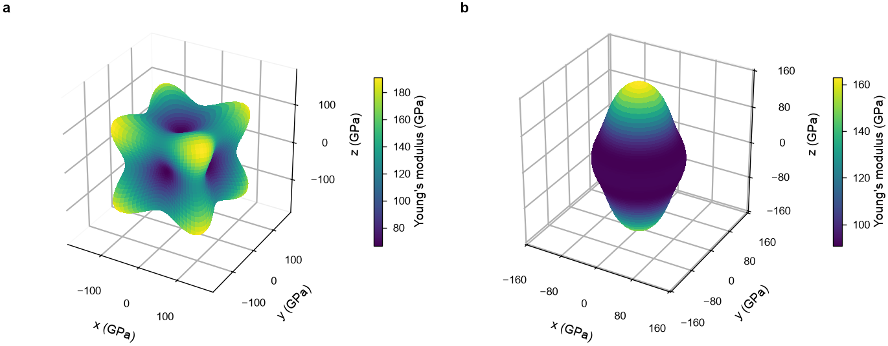

# Elastic constants

`mdapy.lattice_dynamics.elastic_constants(system, calculator, *, strain=1e-3,
relax=True, max_force=1e-4, max_steps=5000, symmetry=None)` gives the elastic constants of a
periodic crystal from its stress under small strains.

<!-- skip-test -->
```python
from mdapy.lattice_dynamics import elastic_constants
from mdapy.simulation import minimize

relaxed = minimize(crystal, potential, cell="full", max_stress=1e-4).system
result = elastic_constants(relaxed, potential)
result.constants  # (6, 6) GPa
result.bulk_modulus(), result.shear_modulus("voigt")
```

!!! warning "Relax the box first"
    The constants are those of the box as it is given. Relax it to zero
    stress first, as above, or the constants belong to a crystal under
    stress.

| Name | Type | Default | Unit | Meaning |
|---|---|---|---|---|
| `system` | `System` | | | the crystal, periodic in every direction, or a [sheet](sheets.md), with a `mass` or an `element` column when its positions relax |
| `calculator` | `Calculator` | | | computes the virial, and energies and forces when the positions relax |
| `strain` | float64 | 1e-3 | | the magnitude $\delta$ of the strains |
| `relax` | bool | `True` | | whether the positions relax in each strained box (relaxed-ion constants) or stay put (clamped-ion constants) |
| `max_force` | float64 | 1e-4 | eV/Å | convergence of each relaxation, as in `minimize`: the largest force left, or 10<sup>−4</sup> of the largest force the strain makes if that is smaller, but no less than 10<sup>−3</sup> `max_force` |
| `max_steps` | int32 | 5000 | | largest number of steps of each relaxation |
| `symmetry` | bool or `None` | `None` | | take the stress under a strain that an operation makes from another as the image of its stress, with the symmetry operations of the crystal, found by [spglib](../analysis/space-group.md): `True`, `False`, or by default whenever spglib is installed |

A cubic crystal takes 3 strains instead of 12: a stretch both ways and a
shear.

The constants of a potential that does not reach zero smoothly at its cutoff can
depend on `strain`, when neighbors lie at the cutoff: so do those of the
[Zhou potentials](eam.md#potentials-of-zhou-johnson-and-wadley) for fcc metals.

A box periodic along two vectors in the x-y plane only makes the system a
[sheet](sheets.md), whose constants are in N/m.

## Along directions

A crystal is stiffer along some directions than along others. The result gives its
Young's modulus and its linear compressibility along any direction, or along each of
many, its shear modulus on any plane along any direction, its Poisson ratio for any
stretch and direction across it, and its anisotropy in one number, zero for an
isotropic crystal. [`plot.elastic_surface`](../visualization/plots.md) draws a quantity
along every direction, and `plot.elastic_section` along the directions of a plane;
[Elastic anisotropy of copper and titanium](../../examples/elastic-anisotropy.md) reads
the results in detail:

```python
from mdapy.build import build_crystal
from mdapy.calculators import EAM
from mdapy.lattice_dynamics import elastic_constants
from mdapy.simulation import minimize
from mdapy.visualization import plot


def constants(structure, a, element, repeat, c=None):
    potential = EAM.zhou([element])
    crystal = build_crystal(structure, a, c=c, elements=element, repeat=repeat)
    relaxed = minimize(crystal, potential, cell="full", max_stress=1e-4).system
    return elastic_constants(relaxed, potential)


copper = constants("fcc", 3.615, "Cu", (3, 3, 3))
titanium = constants("hcp", 2.95, "Ti", (4, 4, 3), c=4.68)  # c along z
print(copper.young_modulus([[1, 0, 0], [1, 1, 0], [1, 1, 1]]))  # GPa
print(copper.universal_anisotropy(), titanium.universal_anisotropy())
print(titanium.linear_compressibility([[1, 0, 0], [0, 0, 1]]))  # 1/GPa

with plot.style():
    fig, (left, right) = plot.figure(
        "double", nrows=1, ncols=2, subplot_kw={"projection": "3d"}
    )
    plot.elastic_surface(copper, ax=left)
    plot.elastic_surface(titanium, ax=right)
    plot.panel_label(left, "a")
    plot.panel_label(right, "b")
    fig.savefig("images/elastic-surfaces.png", dpi=200)
```

```text
[ 66.63540948 130.30363359 191.19854312]
1.8275734112530406 0.3528895390792597
[0.00347453 0.00256451]
```



*The Young's modulus along every direction, with the EAM potentials of Zhou et al.
a: copper, cubic, stiffest along ⟨111⟩ and softest along ⟨100⟩. b: titanium,
hexagonal, stiffest along its c axis and the same in every direction around it.*

The directions are in the axes of the box: those of a crystal built with an
`orientation` turn with it.

## Definition

The box and the atoms are strained by $\pm\delta$ in each of the six
components $k$ of the strain in Voigt order xx, yy, zz, yz, xz, xy, the shear
components as engineering strains (half on each off-diagonal entry), and the
constants are central differences of the stress $\sigma$ (positive under
tension) in the same order:

$$
C_{jk} = \frac{\sigma_j(+\delta\, \mathbf e_k) - \sigma_j(-\delta\, \mathbf e_k)}{2\delta}.
$$

With $S = C^{-1}$, the moduli of a polycrystal are the Voigt and Reuss bounds
and their mean, the Hill average
([Hill (1952)](../../reference/references.md#hill1952)):

$$
\begin{aligned}
K_\mathrm V &= \tfrac19\left[C_{11} + C_{22} + C_{33} + 2(C_{12} + C_{13} + C_{23})\right], &
K_\mathrm R &= \left[S_{11} + S_{22} + S_{33} + 2(S_{12} + S_{13} + S_{23})\right]^{-1}, \\
G_\mathrm V &= \tfrac1{15}\left[C_{11} + C_{22} + C_{33} - (C_{12} + C_{13} + C_{23}) + 3(C_{44} + C_{55} + C_{66})\right], &
G_\mathrm R &= 15\left[4(S_{11} + S_{22} + S_{33}) - 4(S_{12} + S_{13} + S_{23}) + 3(S_{44} + S_{55} + S_{66})\right]^{-1}, \\
K_\mathrm H &= \tfrac12 (K_\mathrm V + K_\mathrm R), &
G_\mathrm H &= \tfrac12 (G_\mathrm V + G_\mathrm R).
\end{aligned}
$$

Along a unit vector $\mathbf n$, the Young's modulus $E$, the stress over the strain of
a stretch along $\mathbf n$ with no stress across it, and the linear compressibility
$\beta$, the relative shortening along $\mathbf n$ per unit of hydrostatic pressure, are

$$
E(\mathbf n) = \left(s_{ijkl}\, n_i n_j n_k n_l\right)^{-1}, \qquad
\beta(\mathbf n) = s_{ijkk}\, n_i n_j,
$$

summed over repeated indices, with the compliance tensor $s_{ijkl}$ the entry of $S$ in
the Voigt order of the pairs $ij$ and $kl$, halved for each of the two that is a shear
([Nye (1985)](../../reference/references.md#nye1985)). The universal anisotropy index
([Ranganathan and Ostoja-Starzewski (2008)](../../reference/references.md#ranganathan2008))

$$
A^\mathrm U = 5\,\frac{G_\mathrm V}{G_\mathrm R} + \frac{K_\mathrm V}{K_\mathrm R} - 6
$$

is zero for an isotropic crystal and positive for any other. On the plane normal to
$\mathbf n$ along $\mathbf m$, perpendicular to it, the shear modulus $G$, and for a
stretch along $\mathbf n$ the Poisson ratio $\nu$, the contraction along $\mathbf m$
over the stretch, are

$$
G(\mathbf n, \mathbf m) = \left(4\, s_{ijkl}\, n_i m_j n_k m_l\right)^{-1}, \qquad
\nu(\mathbf n, \mathbf m) = -\frac{s_{ijkl}\, n_i n_j m_k m_l}{s_{ijkl}\, n_i n_j n_k n_l}.
$$

A polycrystal of grains in every orientation is isotropic, with the bulk modulus $K$
and the shear modulus $G$ of an average, and

$$
E = \frac{9KG}{3K + G}, \qquad \nu = \frac{3K - 2G}{2(3K + G)}.
$$

## Results

It returns an `ElasticResult`:

| Attribute or method | Type | Meaning |
|---|---|---|
| `constants` | (6, 6) float64 | elastic constants $C$ in GPa, in Voigt order; read-only |
| `bulk_modulus(average="hill")` | float64 | the bulk modulus in GPa: the `"voigt"`, `"reuss"` or `"hill"` average |
| `shear_modulus(average="hill", *, normal=None, direction=None)` | float64 or (N,) float64 | the shear modulus in GPa with the same averages; with `normal` and `direction`, that of the crystal sheared on the plane normal to `normal` along `direction`, perpendicular to it, for a pair (3,) float64 or each of pairs (N, 3) float64 |
| `young_modulus(direction=None, *, average="hill")` | float64 or (N,) float64 | the Young's modulus in GPa along a direction (3,) float64, in the axes of the box and of any length, or along each of directions (N, 3) float64; without one, that of a polycrystal from the bulk and shear moduli of `average` |
| `poisson_ratio(direction=None, transverse=None, *, average="hill")` | float64 or (N,) float64 | the Poisson ratio for a stretch along `direction` and the contraction along `transverse`, perpendicular to it, for a pair or each of pairs; without them, that of a polycrystal |
| `linear_compressibility(direction)` | float64 or (N,) float64 | the linear compressibility in 1/GPa, along a direction or directions as for `young_modulus` |
| `universal_anisotropy()` | float64 | the universal anisotropy index $A^\mathrm U$ |
| `errors` | (6, 6) float64 or `None` | standard errors in GPa, from [molecular dynamics](md-elastic.md); None here |

`elastic_constants` raises `InvalidParameter` for a box that is not periodic
in every direction and is not that of a [sheet](sheets.md), a non-positive `strain`, a calculator without the
properties it needs, or a relaxation that does not converge within
`max_steps`. The methods raise it for an unknown `average`, an `average` given with
directions, one of a pair of directions without the other, directions of another shape,
zero, not finite or, in a pair, not perpendicular or of different shapes, and for
constants that cannot be inverted.
