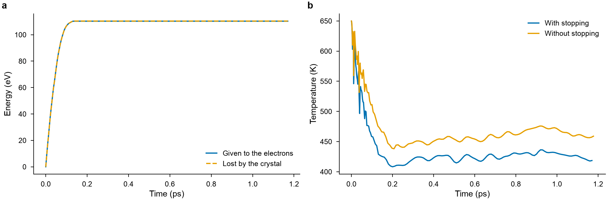

# Electronic stopping

<p class="runs-on" markdown>**Runs on** the processor, on many processes · the [GPU](gpu.md) · [LAMMPS](in-lammps.md) as `fix electron/stopping`</p>

`ElectronicStopping`, a [control](controls.md) of a run of
[molecular dynamics](running.md), slows the fast atoms by the friction of the
electrons. A potential describes how atoms push each other. An atom of a few hundred eV
or more, such as an atom knocked on by a neutron or an ion in a cascade of radiation
damage, also loses energy to the electrons it passes through, and the potential leaves
that loss out.

A primary knock-on atom of 500 eV in copper at 300 K, run with the stopping of
[Lindhard and Scharff (1961)](../../reference/references.md#lindhard1961) and without
it:

```python
import numpy as np

from mdapy import units
from mdapy.build import build_crystal
from mdapy.calculators import EAM
from mdapy.elements import atomic_masses
from mdapy.simulation import MolecularDynamics
from mdapy.simulation.controls import AdaptiveTimestep, ElectronicStopping

copper = EAM.zhou(["Cu"])
crystal = build_crystal(
    "fcc", 3.615, elements="Cu", repeat=(14, 14, 14)
)  # 10 976 atoms
with MolecularDynamics(crystal, copper, timestep=0.002) as md:
    md.velocities(600, seed=1)
    md.run(500, ensemble="nvt", temperature=300)
    warm = md.system

# the stopping of copper in copper of Lindhard and Scharff, proportional to the speed
z, a0, e2 = 29.0, 0.529177, 14.399645  # the Bohr radius in Å, e² in eV Å
bohr = 21876.9  # the Bohr velocity, Å/ps
density = 4 / 3.615**3  # atoms per ų
area = 8 * np.pi * e2 * a0 * z ** (1 / 6) * z * z / (2 * z ** (2 / 3)) ** 1.5  # eV Ų
mass = atomic_masses(["Cu"])[0]
energies = np.geomspace(1.0, 2000.0, 100)  # eV
speeds = np.sqrt(2 * energies / (mass * units.AMU_A2_PER_PS2_TO_EV))  # Å/ps
stopping = ElectronicStopping({"Cu": (energies, density * area * speeds / bohr)})

# the atom nearest the middle of the box sent at 500 eV along a direction of no symmetry
middle = int(np.argmin(np.linalg.norm(
    warm["positions"] - warm.box.matrix.sum(axis=0) / 2, axis=1)))  # fmt: skip
direction = np.array([0.32, 0.55, 0.77]) / np.linalg.norm([0.32, 0.55, 0.77])
v = warm["velocities"].copy()
v[middle] = np.sqrt(2 * 500.0 / (mass * units.AMU_A2_PER_PS2_TO_EV)) * direction
shot = warm.with_columns(velocities=v)

runs = {}
for name, controls in (("with", [stopping]), ("without", [])):
    with MolecularDynamics(shot, copper, timestep=0.001) as md:
        md.run(1500, thermo=10, controls=[AdaptiveTimestep(0.05), *controls])
        runs[name] = md.thermo
```

`thermo` records `electronic_loss`, the energy the atoms gave the electrons since the
run began. It is what the total energy of the crystal lost:

```python
from mdapy.visualization import plot

with plot.style():
    fig, (a, b) = plot.figure("double", 60, nrows=1, ncols=2)
    with_ = runs["with"]
    t = with_["time"].to_numpy()
    a.plot(t, with_["electronic_loss"], label="Given to the electrons")
    a.plot(t, with_["total_energy"][0] - with_["total_energy"], "--",
           label="Lost by the crystal")  # fmt: skip
    a.set(xlabel="Time (ps)", ylabel="Energy (eV)")
    a.legend()
    for name, run in runs.items():
        b.plot(run["time"], run["temperature"], label=f"{name.capitalize()} stopping")
    b.set(xlabel="Time (ps)", ylabel="Temperature (K)")
    b.legend()
    for ax, label in zip((a, b), "ab"):
        plot.panel_label(ax, label)
    plot.save(fig, "images/electronic-stopping", formats=("png",))
```



*a: The energy the atoms gave the electrons, and the total energy the crystal lost,
the same to 0.2 eV. Within 0.12 ps the atoms of the cascade have slowed below 10 eV,
and the electrons have taken 110 eV, a fifth of the 500 eV. b: The temperature of the
crystal, 650 K at first with the 500 eV of the knock-on atom, which the crystal then
shares between kinetic and potential energy. With stopping it settles 40 K lower, the
110 eV the electrons took.*

## Parameters

`ElectronicStopping(stopping, *, min_energy=10.0, min_neighbors=1, mask=None)`, given
to `run` or `iterate` by `controls`, one in a run.

| Name | Type | Default | Unit | Meaning |
|---|---|---|---|---|
| `stopping` | dict | | eV, eV/Å | for each element, `(energies, values)`: kinetic energies, positive and ascending, the same for every element, and the electronic stopping power at each; linear in between |
| `min_energy` | float64 | 10.0 | eV | the kinetic energy below which an atom feels none |
| `min_neighbors` | int32 | 1 | | the atoms an atom needs closer than the cutoff of the potential to feel it, so that an atom that left the material feels none; 0 for none |
| `mask` | (N,) bool | `None` | | the atoms that may feel it; `None`, every atom |

`ElectronicStopping.read(path, elements, **options)` reads a table in the format of
LAMMPS: a line for each energy in eV, followed by the stopping power in eV/Å of each
element in turn, in the order of `elements`; what follows a `#` on a line is a
comment. `options` are `min_energy`, `min_neighbors` and `mask`.

| Name | Type | Meaning |
|---|---|---|
| `path` | str or os.PathLike | the file |
| `elements` | sequence of str | the element of each column after the energy |

## Results

| Column of `thermo` | Type | Unit | Meaning |
|---|---|---|---|
| `electronic_loss` | float64 | eV | the energy the atoms gave the electrons since the run began |

## How it acts

- At each step, after the forces of the potential, each atom of the group with a
  kinetic energy $E = m |\mathbf{v}|^2 / 2$ of `min_energy` or more and of the first
  energy of the table or more, and with `min_neighbors` atoms or more closer than the
  cutoff of the potential, feels
  $$\mathbf{F} = -S_e(E)\, \frac{\mathbf{v}}{|\mathbf{v}|},$$
  where $\mathbf{v}$ is its velocity in the middle of the step, as velocity Verlet has
  it when the forces are computed, and $S_e$ is linear in the table between the
  energies on either side of $E$.
- The forces at the start of a run, before its first step, have none, as in LAMMPS.
- `electronic_loss` adds $S_e |\mathbf{v}|\, \Delta t$ of each atom at each step.
- The stopping of a table is that of an atom in the material, usually from
  [SRIM](http://www.srim.org) with its stopping in eV/Å; at the energies of the atoms
  of a cascade it is about proportional to the speed, as in the example.
- On the [GPU](gpu.md) it acts on the device. On [many processes](processes.md) each
  process slows its own atoms, and the runs are those of one process, to the rounding
  of the forces.
- In LAMMPS it is `fix electron/stopping`, and the runs are those of MDAPY, step by
  step. LAMMPS counts the neighbors within the cutoff and the skin of its neighbor
  list, 2 Å in metal units, and MDAPY within the cutoff; an atom between the two, near
  a surface, feels it in LAMMPS and not in MDAPY.

## Errors

`ElectronicStopping` raises `InvalidParameter` for a `stopping` that is not a
dictionary of `(energies, values)`, energies that are not positive and ascending or
differ between the elements, fewer than two energies, values that are negative or
not finite, a negative `min_energy`, and a `min_neighbors` that is not a whole number
of 0 or more. `read` raises it for a file it cannot read, or one without a column for
each element.

A run raises `InvalidParameter` for a second `ElectronicStopping`, a `mask` of another
number of atoms, atoms of the group of an element without a table, atoms without an
`element` column, and `min_neighbors` above 0 with a calculator without a cutoff. It
raises `CalculationFailed` when an atom that feels it is faster than the last energy
of the table.

## See also

- [`fix electron/stopping`](https://docs.lammps.org/fix_electron_stopping.html) of LAMMPS
- [SRIM](http://www.srim.org), the stopping and range of ions in matter
