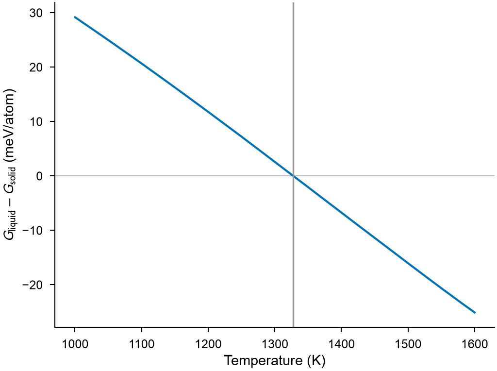

# Free energy

`mdapy.simulation.free_energy(system, potential, temperatures)` gives the free
energy of a solid or a liquid per atom from molecular dynamics in
[LAMMPS](lammps.md): at one temperature by switching to a system whose free energy
is known, and from there to other temperatures by the enthalpy along a run.

<!-- skip-test -->
```python
import numpy as np

from mdapy.build import build_crystal
from mdapy.calculators import LAMMPS
from mdapy.simulation import free_energy, minimize

potential = LAMMPS(
    "pair_style eam/alloy\npair_coeff * * Cu_mishin1.eam.alloy Cu", elements=["Cu"]
)
crystal = minimize(
    build_crystal("fcc", 3.615, elements="Cu", repeat=(11, 11, 11)),
    potential,
    cell="full",
    max_stress=1e-4,
).system

temperatures = np.arange(1000.0, 1601.0, 25.0)
options = dict(switching=100, scan=300, repeats=2)
solid = free_energy(crystal, potential, temperatures, **options)
liquid = free_energy(
    crystal, potential, temperatures[::-1], phase="liquid", equilibration=15, **options
)
solid.free_energy  # eV per atom at each temperature
melting = solid.crossing(liquid)
melting.temperature, melting.latent_heat  # 1328 K, 0.124 eV per atom
```

The two phases of copper meet at its melting point:

<!-- skip-test -->
```python
from mdapy.visualization import plot

with plot.style():
    fig, ax = plot.figure("single")
    difference = liquid.free_energy[::-1] - solid.free_energy
    ax.plot(solid.temperatures, 1e3 * difference)
    ax.axhline(0.0, color="0.75", lw=0.5, zorder=0)
    ax.axvline(melting.temperature, color="0.6", lw=0.8)
    ax.set_xlabel("Temperature (K)")
    ax.set_ylabel(r"$G_\mathrm{liquid} - G_\mathrm{solid}$ (meV/atom)")
    plot.save(fig, "images/free-energy", formats=("png",))
```



*Copper with the EAM potential of Mishin et al., 5324 atoms: the liquid has the lower
free energy above 1328 K. A millielectronvolt per atom is 11 K here.*

These are the free energies of exactly these atoms in their periodic box, so they depend
a little on the number of atoms, and so does where the phases meet: 2048 atoms of the same
copper give 1331 K.

!!! warning "A smooth potential"
    The potential must be continuous at its cutoff, as those fitted for metals
    are; a Lennard-Jones potential needs `pair_modify shift yes`. A jump of the
    energy at the cutoff is in the energies the integrals read, but not in the
    forces that move the atoms, and it gave an error of 1.6 meV per atom at 60 K in
    a crystal of argon.

The atoms are classical, as in molecular dynamics: the free energy has no
zero-point energy, and well below the Debye temperature the
[quasi-harmonic approximation](quasi-harmonic.md) is better. LAMMPS needs its
packages `EXTRA-FIX`, for solids, and `EXTRA-PAIR`, for liquids.

| Name | Type | Default | Unit | Meaning |
|---|---|---|---|---|
| `system` | `System` | | | the atoms, with an `element` column, in a box periodic in every direction: for a solid at their places in the crystal (relax them first), for a liquid anywhere, as it is melted first |
| `potential` | `LAMMPS` | | | the interaction; a liquid needs one pair style, not a hybrid |
| `temperatures` | float or array_like | | K | the free energy is calculated at the first and followed from there to the others, which lie on one side of it, in order |
| `phase` | str | `"solid"` | | `"solid"` or `"liquid"` |
| `pressure` | float or None | 0 | GPa | the pressure, for the Gibbs energy; `None` for the Helmholtz energy in the box of `system` |
| `timestep` | float | 0.001 | ps | the time step |
| `equilibration` | float | 10 | ps | the time of each equilibration |
| `switching` | float | 50 | ps | the time of each switching between two interactions |
| `scan` | float | 100 | ps | the time of each run between the first and the last temperature |
| `repeats` | int | 1 | | independent calculations at the first temperature, for `error` |
| `mixing` | bool | `False` | | add the ideal entropy of mixing of a random solid solution, whose atoms do not exchange places in the dynamics; a liquid has it by itself |
| `melt_temperature` | float | twice the first temperature | K | the temperature at which a liquid is melted |
| `barostat` | str | `"aniso"`, `"iso"` for a liquid | | how the box changes, as in [`run`](dynamics.md#running) |
| `seed` | int | 1 | | the seed of the random numbers |
| `progress` | callable | `None` | | called as `progress(done, total)` with the steps run |
| `cancel` | `CancelToken` | `None` | | stops the calculation, which raises `Cancelled` |

Solids start from the first temperature low, near where the crystal is stable, and
go up; liquids start high and come down. A crystal heated too far melts, and a
liquid cooled too far freezes: when the enthalpy of a scan shows this, the scan is
run again short of there, and the temperatures beyond are left out with a warning.
In a scan of 200 ps a crystal kept its structure up to about 1.2 times its melting
point, for copper, aluminum and nickel.

## Results

`free_energy` returns a `FreeEnergyResult`, all per atom; arrays are read-only.

| Attribute | Type | Unit | Meaning |
|---|---|---|---|
| `temperatures` | (T,) array | K | the temperatures |
| `pressure` | float or None | GPa | the pressure |
| `free_energy` | (T,) array | eV | the Gibbs energy, or the Helmholtz energy at constant volume |
| `enthalpy` | (T,) array | eV | the enthalpy, or the energy at constant volume, smoothed |
| `entropy` | (T,) array | eV/K | the entropy, $(H - G)/T$; classical, so negative at low temperatures |
| `volume` | (T,) array | ų | the volume |
| `phase` | str | | `"solid"` or `"liquid"` |
| `error` | float or None | eV | the standard error at the first temperature from the `repeats`; `None` for one |
| `dissipation` | (T,) array | eV | half the difference of the work there and back: near zero when the switching and the scan are slow enough and the phase stays as it is |
| `system` | `System` | | the atoms in the box of the first temperature |

`crossing(other)` gives where this phase and another at the same pressure have the
same free energy, as a `PhaseCoexistence`:

| Attribute | Type | Unit | Meaning |
|---|---|---|---|
| `temperature` | float | K | the temperature |
| `latent_heat` | float | eV | the change of enthalpy to the other phase |
| `entropy` | float | eV/K | the change of entropy |
| `volume` | float | ų | the change of volume |

## Definition

**A solid** at volume $V$ is switched to independent harmonic springs of spring
constants $k_i$ at the places of its atoms, chosen to give each element the mean
square displacement it has in the crystal, and back
([Frenkel and Ladd (1984)](../../reference/references.md#frenkel1984);
[Freitas et al. (2016)](../../reference/references.md#freitas2016)):

$$
F = F_\mathrm{springs} + F_\mathrm{cm} + \frac{1}{2N}
\left[ \int_0^1 (U - U_\mathrm{springs})\, d\lambda
- \int_1^0 (U - U_\mathrm{springs})\, d\lambda \right],
$$

with the forces $(1-\lambda)$ of the crystal and $\lambda$ of the springs, and

$$
F_\mathrm{springs} = \frac{3 k_B T}{N} \sum_i \ln\frac{\hbar\omega_i}{k_B T},
\qquad
F_\mathrm{cm} = \frac{k_B T}{N} \ln\left[ \frac{N}{V}
\left( 2\pi \sum_i \frac{m_i^2}{M^2} \frac{k_B T}{k_i} \right)^{3/2} \right]
$$

for the center of mass, held fixed. Half the difference of the two ways removes the
heat lost on the way.

**A liquid** at volume $V$ is switched in the same way to the Uhlenbeck-Ford model
$U_\mathrm{UF} = -p\,k_B T \ln(1 - e^{-r^2/\sigma^2})$, with $p = 50$ and
$\sigma = 1.5$ Å ([Paula Leite et al. (2016)](../../reference/references.md#paulaleite2016)),
which is switched in turn from nothing, the ideal gas:

$$
F = F_\mathrm{gas} + \frac{1}{N} \int_0^1 \langle U_\mathrm{UF} \rangle_\lambda\, d\lambda
+ \frac{1}{N} \int_0^1 \langle U - U_\mathrm{UF} \rangle_\lambda\, d\lambda.
$$

**Between temperatures** the free energy follows the enthalpy $H$ along runs with
the temperature changing there and back, of which the mean is taken:

$$
\frac{G(T)}{T} = \frac{G(T_0)}{T_0} - \int_{T_0}^{T} \frac{H(T')}{T'^2}\, dT'.
$$

The Gibbs energy at pressure $P$ is $G = F + PV$, with $V$ the mean volume at the
first temperature and $P$.

## Errors

`free_energy` raises `InvalidParameter` for invalid options, a box not periodic in
every direction, a hybrid pair style for a liquid, a liquid whose atoms do not move
from their neighbors, a phase that changes in every scan, or if LAMMPS fails;
`MissingProperty` for a system without an `element` column; `Cancelled` when
cancelled. `crossing` raises `InvalidParameter` for other pressures, temperatures
that do not overlap, or free energies that do not cross between them.

!!! quote "Please cite"
    [Frenkel and Ladd (1984)](../../reference/references.md#frenkel1984) and
    [Freitas et al. (2016)](../../reference/references.md#freitas2016) for solids;
    [Paula Leite et al. (2016)](../../reference/references.md#paulaleite2016) for
    liquids.
