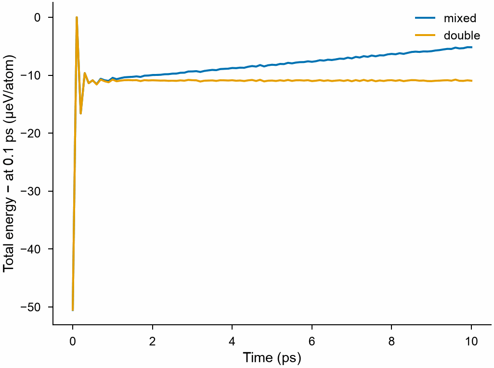

<!-- needs: gpu -->

# On the GPU

<p class="runs-on" markdown>**Runs on** an NVIDIA GPU, with the GPU part of MDAPY: see [Installing the GPU part](#installing-the-gpu-part)</p>

The potentials of MDAPY compute on an NVIDIA GPU with CUDA, and
[molecular dynamics](running.md) with them runs there whole, for systems of
hundreds of thousands to millions of atoms: `device="cuda"` puts a potential on the
GPU, and `MolecularDynamics` runs on the GPU with a potential that is there.

```python
from mdapy.build import build_crystal
from mdapy.calculators import EAM
from mdapy.simulation import MolecularDynamics

potential = EAM.zhou(["Cu"], device="cuda")  # mixed precision
crystal = build_crystal(
    "fcc", 3.615, elements="Cu", repeat=(40, 40, 40)
)  # 256 000 atoms

with MolecularDynamics(crystal, potential, timestep=0.002) as md:
    md.velocities(600, seed=1)
    md.run(5000, ensemble="npt", temperature=300, pressure=0.0, thermo=100)
    hot = md.system
```

The calls are those of the processor, and so are the results: `thermo`, `frames`,
`iterate` and `system` give what they give there. The GPU keeps the atoms, their
neighbor list and the steps of the integrator; each step copies back only the few
numbers the thermostat and the barostat need, and the atoms come back when a frame or
the system is asked for.

The total energy of copper at 600 K at constant energy, in mixed and in double
precision:

```python
import numpy as np
from mdapy.visualization import plot

energies = {}
for precision in ("mixed", "double"):
    copper = EAM.zhou(["Cu"], device="cuda", precision=precision)
    with MolecularDynamics(crystal, copper, timestep=0.002) as md:
        md.velocities(600, seed=1)
        md.run(5000, thermo=50)
        thermo = md.thermo
    energies[precision] = (thermo["time"], thermo["total_energy"] / len(crystal))

with plot.style():
    fig, ax = plot.figure("single")
    for precision, (time, energy) in energies.items():
        ax.plot(time, 1e6 * (energy - energy[1]), label=precision)
    ax.set(xlabel="Time (ps)", ylabel="Total energy − at 0.1 ps (µeV/atom)")
    ax.legend()
    plot.save(fig, "images/gpu-energy", formats=("png",))
```



*The total energy of 256 000 copper atoms at constant energy from 600 K, from its
value at 0.1 ps. In the first picosecond, alike in both precisions, it is the error of
the time step of 2 fs, as the atoms leave the perfect crystal, where no force acts.
After it, double precision keeps the energy to 0.2 µeV per atom, and mixed precision
lets it drift by less than 0.1 µeV per atom per ps.*

## Installing the GPU part

The GPU part of MDAPY is a package of its own, `mdapy-cuda12`, built with CUDA 12 for
Linux on x86-64 and on ARM (aarch64, as the GH200), which pip installs with MDAPY at its
version:

```bash
pip install "mdapy[cuda12]"
```

It runs on NVIDIA GPUs from the V100 on (compute capability 7.0: V100, T4, A100, the
RTX 20, 30, 40 and 50 series, L40, H100, GH200, B200) with the driver of the GPU, 525
or newer, whatever CUDA toolkit the machine has, if any: the CUDA runtime is linked
into it, and newer drivers run it too.
`mdapy.show_versions()` names the GPU part and the GPU it found, in its row
`GPU part`. Where there is no such package, on Windows or on the Jetson boards,
MDAPY is built from its source with the CUDA toolkit (tested with CUDA 12.6, 12.9
and 13.5), which puts the GPU part in MDAPY itself, as the module `mdapy._cuda`:

```bash
pip install mdapy --no-binary mdapy -Ccmake.define.MDAPY_CUDA=ON
```

It is compiled for the GPU of the machine; `-Ccmake.define.CMAKE_CUDA_ARCHITECTURES="80;86;90"`
compiles it for others, such as those of a cluster. A GPU part built into MDAPY is
used before an installed `mdapy-cuda12`.

## Potentials

| Calculator | On the GPU |
|---|---|
| [`EAM`](../potentials/eam.md), `EAM.zhou` and their average atoms | `eam/alloy`, `eam/fs` and funcfl files of `eam` |
| [`LennardJones`](../potentials/pair-potentials.md), [`Morse`](../potentials/pair-potentials.md) | every pair of elements, with `shift` and the mixing rules |
| [`ADP`](../potentials/adp.md) | the dipole and the quadrupole of the neighbors of each atom |
| [`Tersoff`](../potentials/tersoff.md), [`StillingerWeber`](../potentials/stillinger-weber.md) | every triplet of elements; the energy and the virial of each three-body term shared among its atoms as on the processor when the atoms' own are asked for |
| [`MEAM`](../potentials/meam.md) | every reference structure and option of the processor, screening within and beyond rc; the densities of each atom held in double precision |
| [`NEP`](../potentials/nep.md) | NEP4 with and without ZBL, harmonics up to l = 8 and the four- and five-body terms, at most 20 functions of each kind; the descriptors and the network in single precision in mixed precision. `descriptors` stays on the processor |

| Parameter | Type | Default | Meaning |
|---|---|---|---|
| `device` | str | `"cpu"` | `"cpu"`, or `"cuda"` to compute on the GPU |
| `precision` | str | `"mixed"` on the GPU | `"mixed"`: the distance and the terms of each pair in single precision, the positions, the velocities and every sum in double, as the GPU package of LAMMPS in mixed precision; or `"double"` throughout. The processor computes in double precision only |

`compute` of a potential on the GPU copies the atoms there, builds a
[neighbor list](../../basics/neighbor.md) of its own, with a skin of 1 Å that the
next system of as many atoms uses again while it fits, and copies the results back;
a neighbor list given to it is not used. Every calculator has `device` and `precision`.

## Precision

| | Mixed | Double |
|---|---|---|
| Forces, atom by atom | within about 1e-6 of the largest force, up to 6e-6 for Tersoff and MEAM | those of the processor to rounding, 1e-14 |
| Energies | of each atom within about 2e-6 of the largest, the total within 1e-6 | to rounding |
| Total virial | within about 1e-5 of its largest component, more near zero pressure, where its terms cancel | to rounding |
| Molecular dynamics | the same runs as long as rounding allows | the runs of the processor, step by step, in every ensemble |

Single precision holds the position of each atom from the corner of its cell of the
neighbor list, a few Å, so that these hold whatever the size of the box. A pair within
its rounding, some 1e-6 Å, of the cutoff of a potential whose energy does not go to zero
there, such as `LennardJones` and `Morse` without `shift`, may count on one side on the
GPU and on the other on the processor.

In double precision a consumer GPU computes much slower than in single, a part of
its speed in single precision. Langevin dynamics draws its random forces on the GPU:
a seed gives the same run there every time, but not the run of the processor with
that seed.

## Molecular dynamics

`MolecularDynamics` with a potential of the table above on the GPU runs the steps
there too. Other calculators on the GPU, such as the [plane-wave DFT](../potentials/dft.md)
and models of torch, compute there and return their forces; the steps of their atoms
run on the processor, which costs nothing beside them. A potential on the GPU runs
every ensemble, `"nve"`, `"nvt"`,
`"npt"` and `"nph"`, with every barostat and both thermostats, as
[MDAPY's own dynamics](ensembles.md#how-mdapy-integrates) does on the
processor. Along every periodic direction the box must be thicker than twice the
cutoff of the potential and the skin, 1 Å, at every step, also as a barostat changes
it; smaller boxes and small systems are for the processor. A `movable` column holds
atoms along the directions where it is False, and the [controls](controls.md) of a run
hold, move, push and bathe groups of atoms, as on the processor.

## Errors

A potential with `device="cuda"` raises `InvalidParameter` when MDAPY was built
without its GPU part, when there is no GPU, for a `device` or a `precision` not in
the tables above, and for `"mixed"` on the processor; `compute` and
`MolecularDynamics` raise it for a box too thin along a periodic direction. The dynamics raises `CalculationFailed`
when the positions, the energy or the forces stop being finite.

See also: [Molecular dynamics on the GPU](../../performance/gpu.md), how fast it is.
