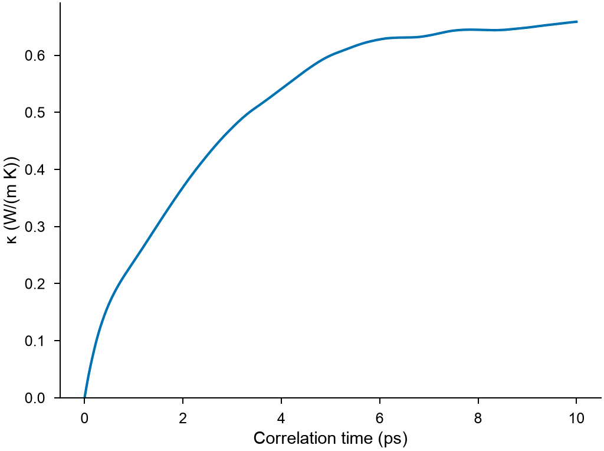

<!-- needs: lammps -->

# Green–Kubo conductivity

`mdapy.lattice_dynamics.green_kubo(system, potential, temperature, ...)` gives the
thermal conductivity of a crystal or a liquid from the fluctuations of the heat flux in
equilibrium [molecular dynamics](dynamics.md) in LAMMPS, by the Green–Kubo relation;
`green_kubo_from_flux` does the same with a heat flux from any molecular dynamics. Unlike
the [relaxation-time approximation](thermal-conductivity.md), it holds every order of
anharmonicity, the atoms move as classical particles, and it needs no force constants.

```python
from mdapy.build import build_crystal
from mdapy.calculators import LAMMPS
from mdapy.lattice_dynamics import green_kubo

argon = LAMMPS("pair_style lj/cut 8.5\npair_coeff * * 0.0104 3.405", elements=["Ar"])
crystal = build_crystal("fcc", 5.28, elements="Ar", repeat=4)  # 256 atoms

result = green_kubo(
    crystal,
    argon,
    40.0,
    timestep=0.004,
    equilibration=5000,
    production=100000,
    every=5,
    correlation=10.0,
)
result.kappa, result.errors  # W/(m K)
result  # GreenKubo(0.6587 ± 0.07 W/(m K) at 38.8035 K), the mean of x, y and z
```

The integral of the correlation of the flux grows over the first picoseconds and then
holds its value, about which it wanders at longer lags by the noise of the correlation:

```python
import numpy as np
from mdapy.visualization import plot

mean = np.trace(result.running, axis1=1, axis2=2) / 3
with plot.style():
    fig, ax = plot.figure("single")
    ax.plot(result.times, mean)
    ax.set(xlabel="Correlation time (ps)", ylabel="κ (W/(m K))", ylim=(0, None))
    plot.save(fig, "images/green-kubo", formats=("png",))
```



*Solid argon of the Lennard-Jones potential at 40 K, 256 atoms over 400 ps: the integral
of the correlation of the heat flux, the mean of x, y and z, up to each correlation
time.*

| Name | Type | Default | Unit | Meaning |
|---|---|---|---|---|
| `system` | `System` | | | the atoms in a box periodic in every direction, of its size at the temperature, with an `element` column |
| `potential` | `LAMMPS` | | | the interaction; a many-body one must give LAMMPS the centroid stress of each atom |
| `temperature` | float64 | | K | the temperature |
| `timestep` | float64 | 0.001 | ps | the time step |
| `equilibration` | int32 | 10000 | | steps at constant temperature first |
| `production` | int32 | 100000 | | steps at constant energy whose heat flux is recorded |
| `every` | int32 | 5 | | steps between the samples of the flux |
| `correlation` | float64 | 10 | ps | the longest lag of the correlation, over which it is integrated |
| `blocks` | int32 | 5 | | the number of blocks of the flux for the standard error |
| `seed` | int32 | 1 | | the seed of the starting velocities |

The atoms first reach the temperature with a Nosé–Hoover thermostat, then run at
constant energy, which the thermostat would disturb, while LAMMPS records the heat flux
every `every` steps: its kinetic and potential parts and the virial of the
[centroid stress](https://docs.lammps.org/compute_stress_atom.html) of each atom, which
is the right one for many-body potentials such as EAM
([Surblys et al. (2019)](../../reference/references.md#surblys2019)). A potential for
which LAMMPS has no centroid stress, such as Stillinger–Weber or Tersoff, is refused.
The temperature of the result is the mean of the run at constant energy.

`green_kubo_from_flux(flux, *, interval, volume, temperature, correlation, blocks=5)`
takes a heat flux of any molecular dynamics: (S, 3) samples of the heat flux times the
volume in eV Å/ps, as LAMMPS's `compute heat/flux` gives it in metal units, every
`interval` ps, with the volume in ų and the temperature in K.

**Converging.** The conductivity of one run is uncertain by its `errors`, from the
spread of the conductivities of `blocks` parts of the flux; longer runs make them
smaller, as one over the square root of the time. `correlation` should be long enough
that the integral has reached its value, and no longer, since the noise of the
correlation grows with the lag: a few times the time over which the integral rises.
Phonons longer than the box are missing, so a small box gives too small a conductivity;
compare boxes of growing size. For argon at 40 K, 500 atoms over 800 ps give
0.75 ± 0.14 W/(m K), and the relaxation-time approximation from the force constants of
the same potential 0.81 W/(m K); the two differ by the orders of anharmonicity the one
holds and the other leaves out, by the classical motion of the atoms, and by the
statistics of the run.

## Results

`green_kubo` and `green_kubo_from_flux` return a `GreenKubo`.

| Attribute | Type | Unit | Meaning |
|---|---|---|---|
| `temperature` | float64 | K | the temperature |
| `volume` | float64 | ų | the volume |
| `times` | (C,) float64 | ps | the lags of the correlation, from 0 |
| `running` | (C, 3, 3) float64 | W/(m K) | the conductivity of the integral up to each lag |
| `kappa` | (3, 3) float64 | W/(m K) | the conductivity, that of the last lag |
| `errors` | (3, 3) float64 | W/(m K) | its standard error, from blocks of the flux |
| `flux` | (S, 3) float64 | eV Å/ps | the heat flux times the volume, at the samples |

Every array is read-only.

## Errors

`green_kubo` raises `InvalidParameter` for a box that is not periodic in every
direction, a temperature or numbers of steps that are not positive, a potential without
the centroid stress of each atom, and the errors of `green_kubo_from_flux` and of
[`MolecularDynamics`](dynamics.md). `green_kubo_from_flux` raises it for a flux that is
not (S, 3) and finite, an interval, volume, temperature or correlation that is not
positive, `blocks` less than 2 or not an integer, and blocks shorter than the
correlation.

## Definition

The heat flux of the atoms is

$$
\mathbf J = \frac{1}{V}\Big[\sum_i e_i \mathbf v_i + \sum_i \mathsf S_i \mathbf v_i\Big],
$$

with $e_i$ the kinetic and potential energy of atom $i$ and $\mathsf S_i$ its centroid
stress times the volume, and the conductivity

$$
\kappa_{\alpha\beta} = \frac{V}{k_B T^2} \int_0^{\tau} \langle J_\alpha(0)\, J_\beta(t)
\rangle\, dt,
$$

each lag of the correlation the mean over every time origin of the samples, the integral
by trapezoids up to `correlation`, and the correlation made symmetric in α and β
([Schelling et al. (2002)](../../reference/references.md#schelling2002)).

!!! quote "Please cite"

    [Schelling et al. (2002)](../../reference/references.md#schelling2002), and
    [Surblys et al. (2019)](../../reference/references.md#surblys2019) for the heat flux
    of many-body potentials.
