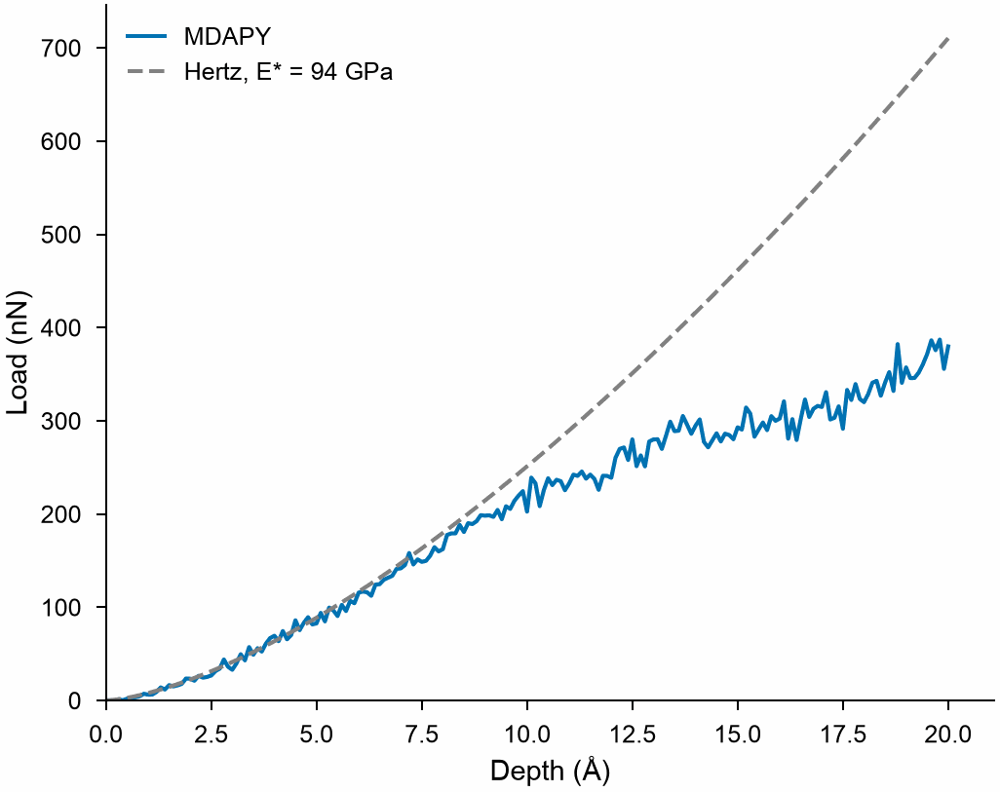
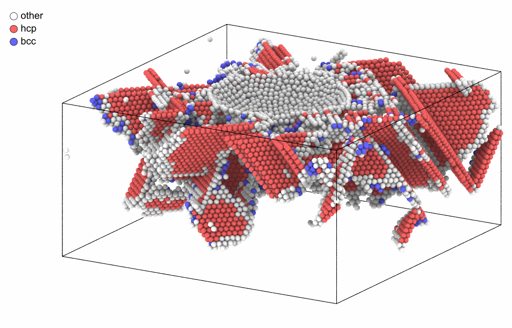

# Indentation

`Indenter`, a [control](controls.md) of a run of [molecular dynamics](dynamics.md), is a
virtual indenter, as LAMMPS's `fix indent`: a sphere, a cylinder or the region beyond a
plane that pushes the atoms inside it out with a force $K d^2$, $d$ how far inside.
Moved at a constant velocity into a crystal, it indents it; the force of the atoms on
it is the load.

A sphere of 4 nm pressed into a film of copper at 50 m/s, on a
[GPU](gpu.md):

<!-- skip-test -->
```python
import mdapy
from mdapy.build import build_crystal
from mdapy.calculators import EAM
from mdapy.simulation import Hold, Indenter, MolecularDynamics

copper = EAM.zhou(["Cu"], device="cuda")
film = build_crystal("fcc", 3.615, elements="Cu", repeat=(40, 40, 20))  # 128000 atoms
with MolecularDynamics(film, copper, timestep=0.002) as md:
    md.velocities(600, seed=1)
    md.run(5000, ensemble="npt", temperature=300, pressure=0.0, barostat="aniso")
    warm = md.system

# open along z: the top a free surface, the lowest 5 Å held
box = mdapy.Box(warm.box.matrix, origin=warm.box.origin, pbc=(True, True, False))
warm = warm.with_box(box)
z = warm["positions.z"]
surface, bottom = float(z.max()), z < z.min() + 5.0
radius = 40.0
middle = warm.box.matrix[0, 0] / 2
tip = Indenter(
    center=(middle, middle, surface + radius + 2.0),
    radius=radius,
    velocity=(0.0, 0.0, -0.5),  # Å/ps, 50 m/s
    name="tip",
)
with MolecularDynamics(warm, copper, timestep=0.002) as md:
    md.run(
        22000, ensemble="nvt", temperature=300, thermo=100, controls=[tip, Hold(bottom)]
    )
    thermo, deepest = md.thermo, md.system
```

The load against the depth below the surface, which the indenter reaches after 4 ps,
with the curve of Hertz for an elastic contact fitted to the first 5 Å,
$P = \tfrac{4}{3} E^* R^{1/2} h^{3/2}$:

<!-- skip-test -->
```python
import numpy as np

from mdapy import units
from mdapy.visualization import plot

nN = units.ELEMENTARY_CHARGE * 1e19  # nN in 1 eV/Å
depth = 0.5 * thermo["time"].to_numpy() - 2.0  # Å
load = np.stack(thermo["tip_force"].to_numpy())[:, 2] * nN
early = (depth > 0) & (depth <= 5.0)
hertz = (load[early] * depth[early] ** 1.5).sum() / (depth[early] ** 3).sum()
modulus = 0.75 * hertz / np.sqrt(radius) * 100.0  # GPa, 1 nN/Ų = 100 GPa
h = np.linspace(0.0, depth.max(), 200)
with plot.style():
    fig, ax = plot.figure("single", 70)
    ax.plot(depth, load, label="MDAPY")
    ax.plot(
        h, hertz * h**1.5, ls="--", color="0.5", label=f"Hertz, E* = {modulus:.0f} GPa"
    )
    ax.set(xlabel="Depth (Å)", ylabel="Load (nN)", xlim=(0, None), ylim=(0, None))
    ax.legend()
    plot.save(fig, "images/indentation-load", formats=("png",))
```



*The load follows the elastic contact of Hertz, with a reduced modulus of 94 GPa, to
about 7 Å; then the crystal yields under the indenter, and the load grows more slowly,
falling back by tens of nN at times as dislocations nucleate and glide away, to 387 nN
at 20 Å. The run took 56 s on one V100.*

The film at the deepest, the atoms below its surface that are not fcc by the
[common neighbor analysis](../analysis/cna.md):

<!-- skip-test -->
```python
from mdapy.identify import CommonNeighborAnalysis
from mdapy.visualization import render

structures = CommonNeighborAnalysis().compute(deepest)
z = deepest["positions.z"]
inside = (z < surface - 3.0) & (z > z.min() + 3.0)  # neither of the free surfaces
render(
    deepest,
    "images/indentation-structures.png",
    atoms=(structures.structure != 1) & inside,
    color=structures,
    view=(0.6, -1.0, -0.35),
    width=1000,
    height=640,
    legend=True,
)
```



*Under the dent, the atoms of the contact in gray, stacking faults on the four {111}
planes, two layers of hcp atoms each, run out from the indenter, bounded by partial
dislocations: some 7000 hcp atoms at 20 Å.*

## Parameters

`Indenter(shape="sphere", *, center=None, radius=None, axis=None, position=None,
side=None, stiffness=10.0, velocity=None, name=None)`, given to `run` or `iterate` by
`controls`.

| Parameter | Type | Default | Unit | Meaning |
|---|---|---|---|---|
| `shape` | str | `"sphere"` | | `"sphere"`, `"cylinder"` along `axis`, or `"plane"` across `axis` |
| `center` | (3,) float64 | | Å | the center of the sphere, or a point on the axis of the cylinder, at the start of the run |
| `radius` | float64 | | Å | the radius of the sphere or of the cylinder, not negative |
| `axis` | str | `None` | | `"x"`, `"y"` or `"z"`: the axis of the cylinder, or that across the plane |
| `position` | float64 | | Å | the coordinate of the plane along its axis at the start of the run |
| `side` | str | `"out"` for a sphere or a cylinder | | `"out"` pushes the atoms out of it, `"in"` keeps them inside it; for a plane `"low"` or `"high"`, the side it fills |
| `stiffness` | float64 | 10.0 | eV/ų | $K$, not negative |
| `velocity` | (3,) float64, or float64 for a plane | `None`, still | Å/ps | the velocity of the center, or of the plane along its axis |
| `name` | str | `None` | | records `<name>_force`, (3,) float64 in eV/Å, the force of the atoms on the indenter, and `<name>_energy` in eV |

## How it acts

- After the forces of the potential, each atom at a distance $r$ from the center of a
  sphere, or from the axis of a cylinder, with $r < R$, feels $K (R - r)^2$ out along
  $r$, and the indenter as much back; its energy is $K (R - r)^3 / 3$. With `side="in"`
  an atom outside, $r > R$, feels $K (r - R)^2$ back in. An atom past a plane by $d$
  feels $K d^2$ back across it.
- The distances are those of the nearest periodic image, as LAMMPS takes them. The
  energy of the indenter is not part of the potential energy, and its forces not part
  of the stress.
- A moving indenter starts where it is given at the start of the run; a run that goes
  on from another needs the position it reached. Held atoms stay held, their forces of
  the indenter removed with the others.
- A rigid indenter of atoms, such as a tip cut from diamond, is a group that a
  [`Move`](controls.md) moves; the force on it is recorded with the name of the `Move`.
- In LAMMPS it is `fix indent` with `units box`, a moving coordinate an equal-style
  variable of the steps of the run; the runs are those of MDAPY, step by step. On the
  [GPU](gpu.md) the indenters act on the device as on the processor.

## Errors

`Indenter` raises `InvalidParameter` for a shape other than `"sphere"`, `"cylinder"` or
`"plane"`, a stiffness or radius that is negative, and the parameters of one shape given
to another or missing: a sphere or a cylinder without a center or a radius, with a
position, or with a side other than `"out"` or `"in"`; a cylinder or a plane without an
axis; a plane without a finite position, without a side `"low"` or `"high"`, with a
center or a radius, or with a velocity that is not one number. `run` and `iterate` raise
it for two controls of one name, an indenter with a [`Deform`](deformation.md), a moving
one with an [`AdaptiveTimestep`](adaptive-timestep.md), a box whose first vector is not
along x or whose second is not in the xy plane, and a plane across an axis along which
the box is periodic.
