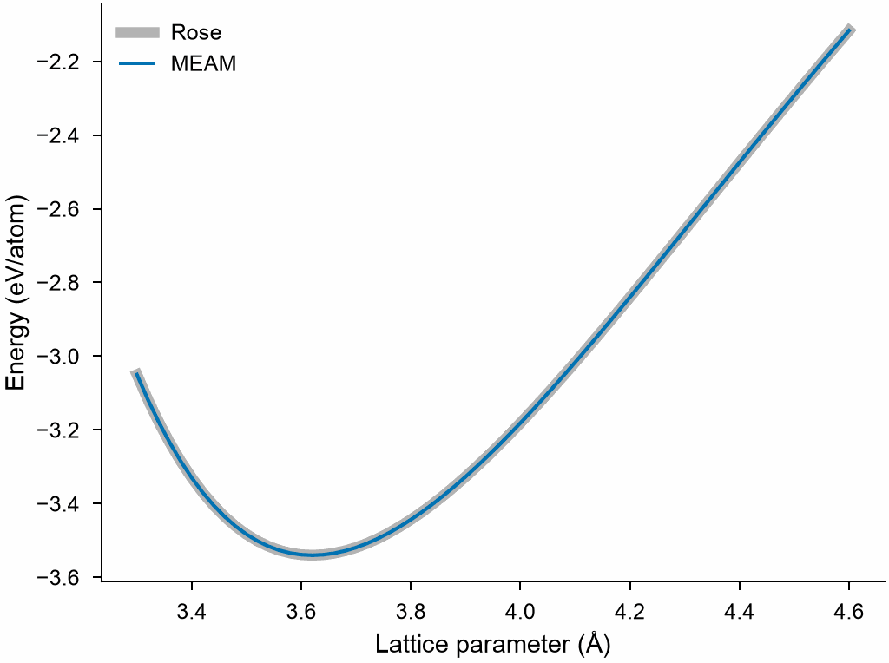

# MEAM

```python
from pathlib import Path

from mdapy.calculators import MEAM

# copper of Baskes (1992), as an entry of a MEAM library file of LAMMPS:
# name lattice z atomic-number mass, alpha b0 b1 b2 b3 alat esub asub,
# t0 t1 t2 t3 rozero ibar
Path("library.meam").write_text(
    "'Cu' 'fcc' 12 29 63.54\n"
    "5.106 3.634 2.20 6.0 2.20 3.62 3.54 1.07\n"
    "1 3.14 2.49 2.95 1.0 3\n"
)
potential = MEAM("library.meam", ["Cu"])
potential.elements, potential.rc, potential.cutoff
```

The energy of copper in its reference crystal, fcc, against the lattice
parameter, and the Rose function of the library:

```python
import numpy as np
from mdapy.build import build_crystal
from mdapy.visualization import plot

lattice = np.linspace(3.3, 4.6, 66)
energy = [
    potential.compute(build_crystal("fcc", a, elements="Cu", repeat=(3, 3, 3))).energy
    / 108
    for a in lattice
]
astar = 5.106 * (lattice / 3.62 - 1)
rose = -3.54 * (1 + astar) * np.exp(-astar)
with plot.style():
    fig, ax = plot.figure("single")
    ax.plot(lattice, rose, color="0.7", lw=3, label="Rose")
    ax.plot(lattice, energy, label="MEAM")
    ax.set_xlabel("Lattice parameter (Å)")
    ax.set_ylabel("Energy (eV/atom)")
    ax.legend()
    plot.save(fig, "images/meam", formats=("png",))
```



*Copper of nearest neighbors in its reference crystal, its second neighbors
screened: MEAM gives the Rose energy of the library at every lattice
parameter, its minimum the cohesive energy 3.54 eV at 3.62 Å.*

`MEAM(library, elements, parameters=None)` reads a library file and a
parameter file of `pair_style meam` of LAMMPS and computes the potential as
LAMMPS does, with the screening of each pair by its neighbors, the reference
structures and the options of the parameter file. The energy of an atom is
its embedding in the background density made of the partial densities of
its neighbors, of orders 0 to 3, and half the pair function of each of its
neighbors, screened (see [Baskes (1992)](../../reference/references.md#baskes1992)
and, for the second neighbors, [Lee and Baskes (2000)](../../reference/references.md#lee2000)):

$$
E_i = F(\bar\rho_i) + \frac{1}{2} \sum_{j} S_{ij} \phi(r_{ij}),
\qquad
\bar\rho_i = \frac{\rho_i^{(0)} G(\Gamma_i)}{\rho_{\text{ref}}},
\qquad
\Gamma_i = \sum_{l=1}^{3} t_i^{(l)} \left( \frac{\rho_i^{(l)}}{\rho_i^{(0)}} \right)^2 .
$$

## Parameters

| Parameter | Type | Meaning |
|---|---|---|
| `library` | str or path-like | the library file: for each element its lattice, coordination, atomic number, mass, α, β0 to β3, lattice constant, cohesive energy, A, t0 to t3, ρ0 and the form of G (ibar), over one or more lines |
| `elements` | sequence of str, or mapping | the entries of the library to use, in the order the indices of the parameter file number them, as the names after the files in `pair_coeff` of LAMMPS. An entry named by an element, as `'Cu'`, is that element; another, as `'AlS'`, the element of its atomic number. A mapping takes the element of the atoms to an entry, as `{"Al": "AlS"}` |
| `parameters` | str, path-like or `None` | the parameter file, lines of `keyword(indices) = value`; `None` for none, as `NULL` in LAMMPS |
| `device` | str | `"cpu"`, or `"cuda"` to compute on an NVIDIA GPU: see [On the GPU](gpu.md) |
| `precision` | str or `None` | on the GPU `"mixed"` (by default) or `"double"`; the processor computes in double precision only |

| Attribute | Type | Meaning |
|---|---|---|
| `library` | str | the library file |
| `parameters` | str or `None` | the parameter file |
| `elements` | tuple of str | the elements of the atoms, in the order of the entries |
| `masses` | (E,) float64 | the masses of the entries in amu |
| `rc` | float64 | the cutoff of the pairs in Å |
| `cutoff` | float64 | the radius in Å of the neighbors needed: rc, or more where an atom farther away screens a pair, up to rc C<sub>max</sub> / (2 (C<sub>max</sub> − 1)<sup>1/2</sup>) for C<sub>max</sub> above 2 |

The keywords of the parameter file are those of LAMMPS: `Ec`, `alpha`,
`rho0`, `delta`, `lattce`, `attrac`, `repuls`, `nn2`, `Cmin`, `Cmax`, `rc`,
`delr`, `augt1`, `gsmooth_factor`, `re`, `ialloy`, `mixture_ref_t`,
`erose_form`, `zbl`, `emb_lin_neg` and `bkgd_dyn`, with their defaults and
the defaults of the alloys of LAMMPS. The reference structures are fcc, bcc,
hcp, dia, dim and sc for an element, and also b1, b2 and l12 for a pair; the
forms of G those of ibar 0, 1, 3, 4 and −5.

The energy of a pair and its virial are shared equally between its two
atoms, and the part of the screening by an atom among the three; the virial
of an atom is symmetric, as in LAMMPS. A potential whose screening reaches
beyond rc, with C<sub>max</sub> above 2, needs neighbors up to `cutoff`;
LAMMPS finds them only within its skin, so its results agree with these when
rc plus the skin reaches `cutoff`.

The reference structures c11, ch4, dia3, lin, zig and tri, the `theta`
keyword, the multi-state MEAM of `pair_style meam/ms` and the spline styles
`meam/spline` and `meam/sw/spline` are not part of `MEAM`.

## Errors

`MEAM` raises `InvalidParameter` for files that cannot be read; entries
named twice, missing from the library, or two of one element without a
mapping; an entry of an unknown lattice, a word for a number, t0 other than
1, ρ0 not positive, or a coordination that is not that of its lattice; an
unknown keyword of the parameter file, too few or out of range indices, a
value that is not a number, an unknown lattice; the reference structures and
keywords above that are not part of it; ibar other than 0, 1, 3, 4 and −5;
`ialloy`, `erose_form` or `mixture_ref_t` out of their range; and atoms of an
element it has no entry for.

!!! quote "Please cite"
    [Baskes (1992)](../../reference/references.md#baskes1992); for second neighbors,
    [Lee and Baskes (2000)](../../reference/references.md#lee2000); and the paper of the parameters.
