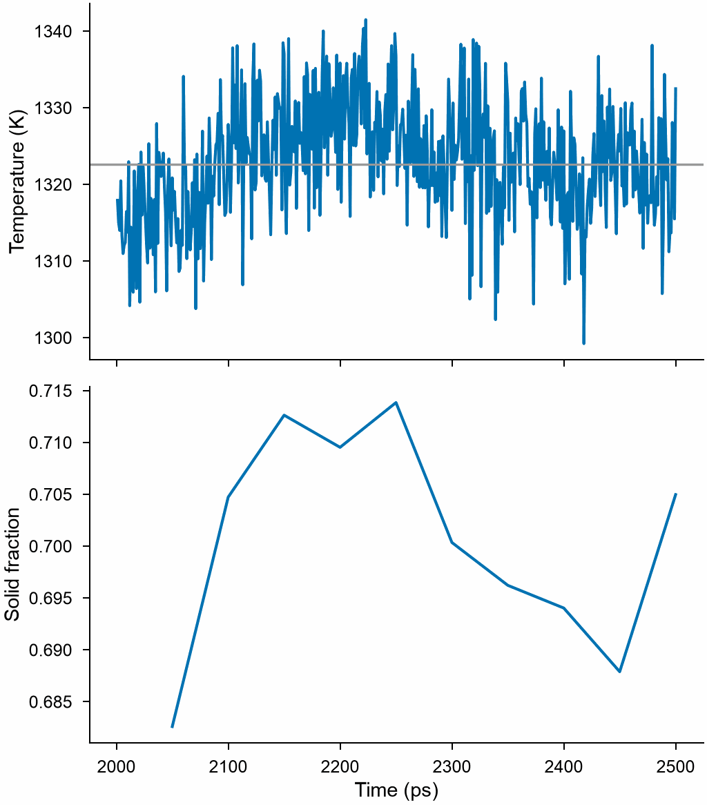

# Melting point

`mdapy.simulation.melting_point(crystal, potential, temperature)` gives the melting
point of a crystal from a first guess, by the two-phase method in
[LAMMPS](lammps.md): a solid and a liquid share a box at constant enthalpy and
pressure, where the interface between them moves until they reach their common
temperature. A run in which one phase takes over gives a new guess, until both last.

<!-- skip-test -->
```python
from mdapy.build import build_crystal
from mdapy.calculators import LAMMPS
from mdapy.simulation import melting_point, minimize

potential = LAMMPS(
    "pair_style eam/alloy\npair_coeff * * Cu_mishin1.eam.alloy Cu", elements=["Cu"]
)
crystal = minimize(
    build_crystal("fcc", 3.615, elements="Cu"), potential, cell="full", max_stress=1e-4
).system

result = melting_point(crystal, potential, 1000.0)
result.temperature, result.error  # 1326 K, 1 K
result.attempts  # how the search went
```

The last run, whose temperature and fraction of solid atoms no longer drift:

<!-- skip-test -->
```python
from mdapy.visualization import plot

with plot.style():
    fig, (top, bottom) = plot.figure("single", 100, nrows=2, sharex=True)
    top.plot(result.time, result.temperatures)
    top.axhline(result.temperature, color="0.6", lw=0.8)
    top.set_ylabel("Temperature (K)")
    bottom.plot(result.fraction_time, result.fractions)
    bottom.set_ylabel("Solid fraction")
    bottom.set_xlabel("Time (ps)")
    plot.save(fig, "images/melting-point", formats=("png",))
```



*Copper with the EAM potential of Mishin et al., 16456 atoms, from a guess of 1000 K. The
runs from 1000 and 1150 K froze, and the one from 1322 K kept both phases and gave 1326 K.
Here is its last stretch.*

The crystal is repeated to about `num_atoms` atoms in a box three times as long along its
third vector as along the others; the interface lies across that vector. Each run:

1. brings the crystal to the temperature and the pressure and takes its mean box;
2. holds one half still and melts the other at constant volume, at twice the
   temperature, hotter until its atoms have moved by about the distance between them;
3. cools the melted half to the temperature and lets it settle;
4. releases the crystal, relaxes the pressure of the box for a moment at this
   temperature, and runs both at constant enthalpy, in stretches of `coexistence`, two
   or more and up to five, until the temperature no longer drifts: neither within the
   last stretch nor from the one before.

A run that melts started too hot and one that freezes too cold, whatever its
temperature became; the next guess is 15 % away, or halfway between two such bounds.
A run that keeps both phases but ends with less than a fifth of one, or with a
temperature that still drifts, starts again from where its temperature was going.

Solid atoms are told from liquid ones by [the order their bonds
share](../analysis/steinhardt.md), with as many neighbors as the first shell of the
crystal has: 12 in fcc and hcp, 14 in bcc, 4 in diamond.

| Name | Type | Default | Unit | Meaning |
|---|---|---|---|---|
| `crystal` | `System` | | | the crystal, relaxed, with an `element` column, periodic in every direction; the interface is across its third vector |
| `potential` | `LAMMPS` | | | the interaction |
| `temperature` | float64 | | K | the first guess |
| `pressure` | float64 | 0 | GPa | the pressure |
| `num_atoms` | int32 | 16000 | | about how many atoms the box holds; fewer for a slow potential |
| `repeat` | (3,) int32 | | | repeats of `crystal` along its vectors, instead of `num_atoms`; the third is made even |
| `timestep` | float64 | 0.001 | ps | the time step |
| `equilibration` | float64 | 10 | ps | the time of each stage before the phases meet |
| `coexistence` | float64 | 500 | ps | the time of each stretch of the two phases; a larger box needs longer |
| `tolerance` | float64 | 3 | K | how much the temperature may still drift, from the third quarter of a stretch to the last and from the stretch before to this one, for it to be the answer; twice its statistical error, if that is larger |
| `max_runs` | int32 | 8 | | the largest number of runs |
| `barostat_damping` | float64 | 1000 time steps | ps | the damping time of the barostat |
| `seed` | int32 | 1 | | the seed of the random numbers |
| `progress` | callable | `None` | | called as `progress(done, total)` with the steps run, of a total that takes every run to be the last |
| `cancel` | `CancelToken` | `None` | | stops the calculation, which raises `Cancelled` |

The size and the time matter. In a small box the temperature and the interface fluctuate
too much, and in a large one heat needs longer to cross it. A slow potential may need less
than the default, through `num_atoms`, `repeat` and `coexistence`, at the price of a larger
spread. For the copper above, from guesses of 1000, 1327 and 1700 K:

| Atoms | `coexistence` (ps) | Melting point (K) |
|---|---|---|
| 4000 | 100 | 1328, 1333, 1326 |
| 4000 | 500 | 1321, 1322, 1321 |
| 16000 | 100 | 1321, 1322, 1320 |
| 16000 | 500 | 1325, 1323, 1325 |

where [the free energies](free-energy.md) of 16384 atoms cross at 1326 K. `error` is the
statistical error of one run and smaller than this spread, so repeating a run with another
`seed` says more about the error than `error` does.

## Results

It returns a `MeltingPointResult`; arrays are read-only.

| Attribute | Type | Unit | Meaning |
|---|---|---|---|
| `temperature` | float64 | K | the melting point: the mean temperature over the second half of the last stretch |
| `error` | float64 | K | the standard error of that mean, from blocks of the stretch: the statistical error of one run, smaller than the spread of runs from other guesses or seeds |
| `pressure` | float64 | GPa | the pressure |
| `attempts` | tuple of `MeltingAttempt` | | each stretch of each run, in order |
| `time` | (S,) float64 | ps | the time along the last stretch |
| `temperatures` | (S,) float64 | K | the temperature along the last stretch |
| `pressures` | (S,) float64 | GPa | the pressure along the last stretch |
| `fractions` | (F,) float64 | | the fraction of solid atoms along the last stretch |
| `fraction_time` | (F,) float64 | ps | the time of the fractions |
| `system` | `System` | | the atoms at the end, with a boolean column `solid` |

A `MeltingAttempt` has `start`, the temperature in K at which its run started;
`outcome`, `"melted"`, `"frozen"` or `"coexisting"`; `temperature`, its mean
temperature in K over its second half; `fraction`, the fraction of solid atoms at its
end; and `drift`, how much in K its mean temperature changed from its third quarter
to its last.

[`free_energy`](free-energy.md) gives the melting point another way, by where the free
energies of the two phases cross.

## Errors

`melting_point` raises `InvalidParameter` for invalid options, a box not periodic in
every direction, half a crystal that does not melt, no run with two phases within
`max_runs`, or if LAMMPS fails; `MissingProperty` for a crystal without an `element`
column; `Cancelled` when cancelled.

!!! quote "Please cite"
    [Morris et al. (1994)](../../reference/references.md#morris1994) for the method.
