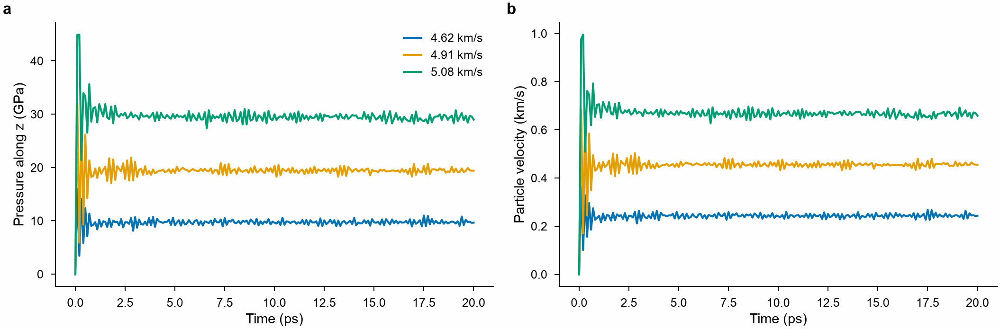

# Multiscale shock technique

`run(..., ensemble="msst")` compresses a periodic box along one axis as a steady
shock wave of a given velocity compresses the matter it passes, as LAMMPS's
`fix msst` does [(Reed et al. 2003)](../../reference/references.md#reed2003): the
length of the box along the axis follows an equation of motion that drives the stress
along it to the Rayleigh line of the shock velocity $U_s$,

$$
P - P_0 = \rho_0 U_s^2 \left(1 - \frac{V}{V_0}\right),
$$

while the atoms keep the energy of the Hugoniot. A small box thus follows the matter
behind a shock front in time, without the front: where a
[Hugoniostat](hugoniostat.md) takes a pressure and gives the shock velocity, MSST takes
the shock velocity and gives the pressure.

Copper at 300 K and no pressure, shocked along z at 4.62, 4.91 and 5.08 km/s for 20 ps:

<!-- skip-test -->
```python
from mdapy.build import build_crystal
from mdapy.calculators import EAM
from mdapy.simulation import MolecularDynamics

copper = EAM.zhou(["Cu"])
crystal = build_crystal("fcc", 3.615, elements="Cu", repeat=8)  # 2048 atoms
with MolecularDynamics(crystal, copper, timestep=0.001) as md:
    md.velocities(600, seed=1)
    md.run(10000, ensemble="npt", temperature=300, pressure=0.0, barostat="aniso")
    warm = md.system

runs = {}
for speed in (46.2, 49.1, 50.8):  # Å/ps
    with MolecularDynamics(warm, copper, timestep=0.001) as md:
        md.run(
            20000,
            ensemble="msst",
            barostat="z",
            shock_velocity=speed,
            msst={"mu": 1.0},
        )
        runs[speed] = md.thermo
```

<!-- skip-test -->
```python
import numpy as np

from mdapy.visualization import plot

with plot.style():
    fig, (a, b) = plot.figure("double", 60, nrows=1, ncols=2)
    for speed, thermo in runs.items():
        pressure = -np.stack(thermo["stress"].to_numpy())[:, 2]
        a.plot(thermo["time"], pressure, label=f"{speed / 10:.2f} km/s")
        b.plot(thermo["time"], thermo["particle_velocity"] / 10)
    a.set(xlabel="Time (ps)", ylabel="Pressure along z (GPa)")
    a.legend()
    b.set(xlabel="Time (ps)", ylabel="Particle velocity (km/s)")
    for ax, label in zip((a, b), "ab"):
        plot.panel_label(ax, label)
    plot.save(fig, "images/msst", formats=("png",))
```



*a: The pressure along z overshoots as the box starts to move, and settles within
3 ps, at 9.7, 19.4 and 29.4 GPa over the last 10 ps. b: The particle velocity
settles at 0.24, 0.46 and 0.67 km/s, at 353, 398 and 445 K. These are the states that
the [Hugoniostat](hugoniostat.md) finds at 10, 20 and 30 GPa, whose shock velocities
are these three, to within 2 %. The distances from the Rayleigh line and from the
Hugoniot average to within 0.01 GPa and 0.1 K.*

## Parameters

The ensemble `"msst"` of [`run` and `iterate`](dynamics.md#running), with these of
their parameters:

| Parameter | Type | Default | Unit | Meaning |
|---|---|---|---|---|
| `barostat` | str | | | the axis of the shock, `"x"`, `"y"` or `"z"`, in a box periodic in every direction with its first vector along x and its second in the xy plane |
| `shock_velocity` | float64 | | Å/ps | the velocity of the shock, not negative |
| `msst` | dict | `None` | | its settings, any of: `"q"`, the mass of the box in amu²/Å⁴ (default 10); `"mu"`, an artificial viscosity in amu/(Å ps) that damps the motion of the box (default 0); `"tscale"`, the share of the kinetic energy of the atoms given to the compression at the start, which sets it off (default 0.01) |
| `hugoniot` | (float64, float64, float64) | `None` | eV, ų, GPa | the reference state: its total energy, volume and pressure along the axis; `None`, the state at the start of the run |

`thermo` records, besides the usual columns:

| Column | Type | Unit | Meaning |
|---|---|---|---|
| `hugoniot` | float64 | K | how far the state is from the Hugoniot, as for the [Hugoniostat](hugoniostat.md#parameters) |
| `rayleigh` | float64 | GPa | how far the pressure along the axis is above the Rayleigh line |
| `particle_velocity` | float64 | Å/ps | the velocity of the matter behind the shock, $U_s (1 - V/V_0)$ |
| `lagrangian_position` | float64 | Å | where the box is in the matter at rest, from where the shock reached it: negative, falling by $U_s V/V_0$ every ps |
| `msst_energy` | float64 | eV | the energy of the motion of the box and of the work of the shock; with `total_energy` it is conserved when `"mu"` is 0, to the error of the integrator |

## How it acts

- MSST replaces the integrator: the volume, its rate and the velocities of the atoms
  move as LAMMPS's `fix msst` moves them, the box scaled along the axis about its
  middle, the velocities along it scaled with it. The other lengths and the tilts of
  the box are kept.
- At the start the reference is taken, unless `hugoniot` gives it, and `"tscale"` of
  the kinetic energy goes into the rate of the volume, against the axis; the
  temperature falls by as much. Each run starts again: a run that goes on from another
  needs the same `hugoniot`.
- Without `"mu"` the box oscillates about the state behind the shock; a viscosity
  damps it there. The pressure, the temperature and the particle velocity at which it
  settles do not depend on `"q"` and `"mu"`, only on how fast it gets there.
- The crystal is compressed homogeneously, without the front of a shock; where it
  starts to flow depends on the size of the box and the length of the run.
- In LAMMPS it is `fix msst` with `q`, `mu` and `tscale`, and `p0`, `v0` and `e0` with
  `hugoniot`; the runs are those of MDAPY, step by step. On the [GPU](gpu.md) it runs
  as on the processor.

## Errors

`run` and `iterate` raise `InvalidParameter` for `"msst"` without a `shock_velocity` or
with a negative one, without an axis in `barostat`, with a pressure, a temperature or
controls, in a box that is not periodic in every direction or not in the form of
LAMMPS, with atoms held by a `movable` column, with a calculator without virials, for
`msst` that is not a dict of `"q"`, `"mu"` and `"tscale"` with `"q"` positive, `"mu"`
not negative and `"tscale"` from 0 to 1, and for `shock_velocity` or `msst` given to
another ensemble.
