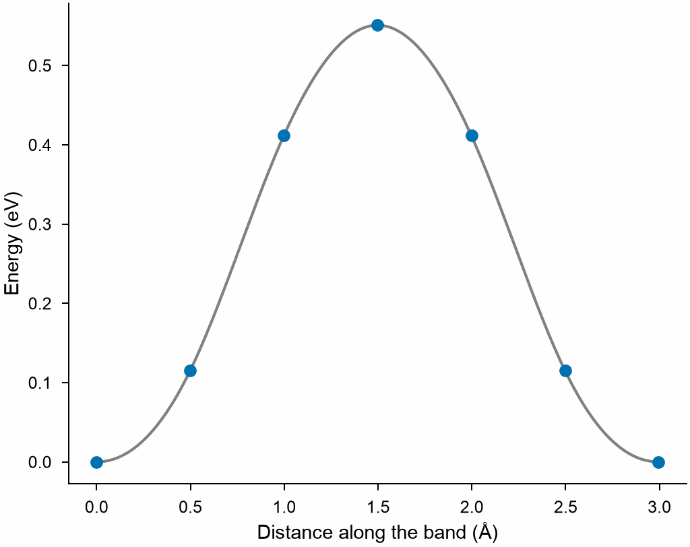

# Minimum energy paths

<p class="runs-on" markdown>**Runs on** the processor · the [GPU](gpu.md) with a potential there · any calculator, each image a calculation of its own</p>

`mdapy.simulation.neb(initial, final, calculator, *, images=5, climb=True,
spring=1.0, interpolation="linear", max_force=0.01, max_steps=1000,
max_step=0.1, timestep=0.001, callback=None, log=None, log_every=10)` finds
the minimum energy path between two states with the nudged elastic band
([Jónsson et al. (1998)](../../reference/references.md#jonsson1998)): a chain
of images between them, each pulled down across the path by the forces of the
potential and kept apart along it by springs, with the tangent of
[Henkelman and Jónsson (2000)](../../reference/references.md#henkelman2000b).
The image of highest energy climbs to the saddle point
([Henkelman et al. (2000)](../../reference/references.md#henkelman2000a)), and
the barrier is its energy above the initial state. The band relaxes by
[FIRE 2.0](minimize.md), the minimization of LAMMPS, and reaches the band of
LAMMPS's `neb` with `fix neb` and `min_style fire`.

A vacancy in copper hops to a neighboring site:

```python
import numpy as np
from mdapy.build import build_crystal
from mdapy.calculators import EAM
from mdapy.simulation import minimize, neb
from mdapy.visualization import plot

potential = EAM.zhou(["Cu"])
a = 3.615
crystal = build_crystal("fcc", a, elements="Cu", repeat=(4, 4, 4))
x = crystal["positions"]
neighbor = np.argmin(np.linalg.norm(x - [a / 2, a / 2, 0.0], axis=1))
hopped = x.copy()
hopped[neighbor] = x[0]  # the neighbor in the place of atom 0
keep = np.arange(len(crystal)) > 0  # atom 0 leaves the vacancy

# the two states, each relaxed: the vacancy before and after the hop
initial = minimize(crystal.filter(keep), potential, max_force=1e-4).system
final = crystal.with_columns(positions=hopped).filter(keep)
final = minimize(final, potential, max_force=1e-4).system

band = neb(initial, final, potential, images=5, max_force=1e-3)
print(f"{band.barrier:.3f} eV after {band.steps} steps")  # 0.551 eV after 82 steps

distance, energy = band.profile()
with plot.style():
    fig, ax = plot.figure("single", 70)
    ax.plot(distance, energy - band.energies[0], color="0.5")
    ax.plot(band.distances, band.energies - band.energies[0], "o")
    ax.set_xlabel("Distance along the band (Å)")
    ax.set_ylabel("Energy (eV)")
    plot.save(fig, "images/neb", formats=("png",))
```



*The five images between the two states and the energy between them. The
middle image climbed to the saddle point, where the hopping atom squeezes
between the four atoms that neighbor both its old and its new site: 0.551 eV
with Zhou's EAM.*

| Name | Type | Default | Unit | Meaning |
|---|---|---|---|---|
| `initial`, `final` | `System` | | | the two states, each a minimum of the energy (relaxed with [`minimize`](minimize.md)), with the same atoms in the same order and the same box, and a `mass` or an `element` column; a `movable` column of the initial state, (N, 3) bool, keeps each atom still where it is False |
| `calculator` | `Calculator` or sequence of `Calculator` | | | computes energies and forces; or one for each image, which then compute at the same time, below |
| `images` | int32 or sequence of `System` | 5 | | number of images between the states, or the images to start from, such as those of an earlier band |
| `climb` | bool | True | | whether the image of highest energy climbs to the saddle point |
| `spring` | float64 | 1.0 | eV/Ų | constant of the springs between images (the `Kspring` of LAMMPS's `fix neb`) |
| `interpolation` | str | `"linear"` | | how the images start: `"linear"`, on the straight line between the states, each atom by its shortest periodic displacement; `"idpp"`, relaxed from it on the image dependent pair potential |
| `max_force` | float64 | 0.01 | eV/Å | converged when no force of the band on an atom of an image exceeds it |
| `max_steps` | int32 | 1000 | | largest number of steps |
| `max_step` | float64 | 0.1 | Å | an atom goes at most this far along x, y or z in one step |
| `timestep` | float64 | 0.001 | ps | first time step of the FIRE dynamics of the band |
| `callback` | callable | `None` | | called after each step as `callback(step, images, energies, max_force)`, with the band as a tuple of `System`; returning True stops it |
| `log` | str, path or stream | `None` | | writes the relaxation of the band to this file, which it overwrites, or to this stream, as the [log of molecular dynamics](records.md#log) does: a heading, then `step`, `max_force` (eV/Å), `barrier` (eV), `highest` (the image of highest energy) and `wall` (s) every `log_every` steps and at the last, and how it ended |
| `log_every` | int32 | 10 | | writes a row to the log every this many steps |

It returns an `NEBResult`:

| Attribute | Type | Meaning |
|---|---|---|
| `images` | tuple of `System` | the band, the two states first and last, each with the `forces` of the calculator as a column and its `energy` in `info` |
| `energies` | (M,) float64 | energy of each image in eV |
| `distances` | (M,) float64 | distance of each image from the first along the band in Å, the lengths of the steps between images over all atoms added up |
| `barrier` | float64 | highest energy of the band less that of the initial state, in eV |
| `highest` | int32 | index of the image of highest energy; with `climb`, on the saddle point |
| `converged` | bool | whether no force of the band exceeds `max_force` |
| `steps` | int32 | number of steps taken |
| `max_force` | float64 | largest force of the band on an atom of an image, in eV/Å |

`profile(points=200)` gives the energy along the band between the images, a
cubic between each two through their energies with the slopes the forces give
along the band, as `(distances, energies)`. The barrier back is
`band.energies.max() - band.energies[-1]`.

## The band

Each image between the two states feels the forces of the potential across
the band, their part along its tangent taken away, and the springs along it,
whose force is the constant times the step to the next image less the step from
the previous: the images slide down to the path and stay apart along it. The
tangent points to the neighbor of higher energy, and mixes the two by their
energies at a maximum or a minimum, so that the band neither kinks nor
bunches. The climbing image feels no springs and the force of the potential
along the band reversed: it goes up along the band and down across it, to the
saddle point, where every force vanishes. Without `climb` the highest image
sits below the saddle, between images, and `profile` comes closer to it.

The band starts on the straight line between the states. Where atoms turn,
as a molecule or a group on a surface does, the straight line brings them too
close; `interpolation="idpp"` first relaxes it on the image dependent pair
potential of [Smidstrup et al. (2014)](../../reference/references.md#smidstrup2014),
which keeps the distance of each pair of atoms within 6 Å near that
interpolated between the two states. The band finds the path nearest its
start: where two paths lead from one state to the other, start it near the
one sought, or give the images to start from.

The states must be minima of the same calculator: relax them with
[`minimize`](minimize.md) first. The images then move by the FIRE dynamics of
LAMMPS, all together as one system, with the masses of the atoms. LAMMPS runs
the band first without a climbing image, then climbs with the image highest at
that moment; MDAPY climbs from the start with whichever image is highest, as
ASE does, and reaches the same saddle.

## Calculators

With one calculator the images compute one after another, each with every
thread of MDAPY's potentials or on the GPU: the fastest for MDAPY's own
potentials, where a step of the band costs about as much as computing each
image once. With one calculator for each image, they compute at the same time,
each in a thread of its own: for calculators that each run on their own, such
as [VASP](../potentials/vasp.md), each in a directory of its own, in a job that
has the processors for all of them:

<!-- skip-test -->
```python
from mdapy.calculators import VASP

incar = {"ENCUT": 400, "EDIFF": 1e-6, "ISMEAR": 1, "SIGMA": 0.2}
command = "srun --exact -n 32 vasp_std"  # 32 processes for each image
calculators = [
    VASP(incar, kpoints=(2, 2, 2), command=command, directory=f"neb/{k:02d}")
    for k in range(1, 6)
]
band = neb(initial, final, calculators, images=5, max_force=0.05)
```

The band of a machine-learned potential is a good start for one of DFT: give
its images, `images=band.images[1:-1]`, to start the band of VASP near its end.

`neb` raises `InvalidParameter` for states with other atoms, elements or
boxes, images that do not fit them, a number of images below 1, an unknown
`interpolation`, a non-positive `spring`, `max_force`, `max_step`,
`timestep` or `log_every`, a negative `max_steps`, calculators that do not
compute energies and forces or are not one for each image, or a `log` that
cannot be written;
[`MissingProperty`](../../reference/api/utilities.md#mdapy.errors.MissingProperty)
for states with neither masses nor elements; and
[`CalculationFailed`](../../reference/api/utilities.md#mdapy.errors.CalculationFailed)
when an energy or a force is not finite.

!!! quote "Please cite"
    [Henkelman et al. (2000)](../../reference/references.md#henkelman2000a), [Henkelman and Jónsson (2000)](../../reference/references.md#henkelman2000b) and, with `interpolation="idpp"`, [Smidstrup et al. (2014)](../../reference/references.md#smidstrup2014).
