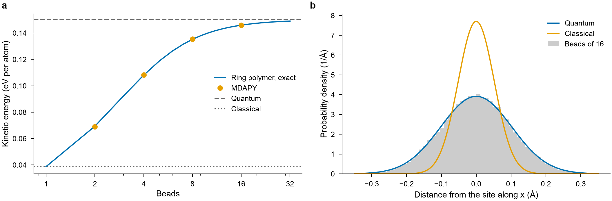

# Path integrals

<p class="runs-on" markdown>**Runs on** the processor, the beads on [many processes](processes.md) · the forces on the [GPU](gpu.md) · not in LAMMPS</p>

`MolecularDynamics(system, potential, beads=P)` treats the nuclei as quantum
particles: path-integral molecular dynamics, in which each atom is a ring polymer of
`P` beads joined by springs, and each bead feels the whole potential. Light atoms
(hydrogen, lithium, helium) and any atom well below its Debye temperature are quantum:
they keep a zero-point energy and spread over a larger region than classical atoms,
which changes structures, heat capacities, thermal expansion and the diffusion of
hydrogen. As the number of beads grows, the averages become those of the quantum
nuclei.

Hydrogen atoms tied by springs of $\hbar\omega = 0.2$ eV at 300 K, harmonic
oscillators whose quantum energies are known, for 2 to 16 beads:

```python
import math

import numpy as np

import mdapy
from mdapy import units
from mdapy.calculators import Springs
from mdapy.simulation import MolecularDynamics

kb, hbar = units.BOLTZMANN, units.PLANCK / (2 * math.pi)  # eV/K, eV ps
temperature, quantum = 300.0, 0.2  # K, ħω in eV
w = quantum / hbar  # 1/ps
rng = np.random.default_rng(0)
sites = rng.uniform(0, 20, (32, 3))
atoms = mdapy.System(sites, mdapy.Box(20.0), elements="H")
stiffness = 1.008 * w * w * units.AMU_A2_PER_PS2_TO_EV  # eV/Ų, m ω²
springs = Springs(sites, np.full(len(atoms), stiffness))

kinetic, spreads = {}, {}
for beads in (2, 4, 8, 16):
    with MolecularDynamics(atoms, springs, timestep=0.0005, beads=beads) as md:
        md.velocities(temperature, seed=1)
        options = {"ensemble": "nvt", "thermostat": "langevin",
                   "temperature": temperature, "thermostat_damping": 0.05}  # fmt: skip
        md.run(1000, **options)  # to equilibrium
        spread = []  # where the beads are along x, every 50 steps
        for frame in md.iterate(4000, thermo=10, save_every=50, **options):
            for bead in md.beads:
                d = bead["positions"][:, 0] - sites[:, 0]
                spread.append(d - 20.0 * np.round(d / 20.0))  # the nearest image
        thermo = md.thermo.filter(md.thermo["step"] > 1000)
        kinetic[beads] = thermo["kinetic_energy"].mean() / len(atoms)  # eV per atom
        spreads[beads] = np.concatenate(spread)
```

The kinetic energy of each atom against the number of beads, and where the beads of
16 are:

```python
from mdapy.visualization import plot

beta = 1 / (kb * temperature)


def ring_polymer(beads):  # the kinetic energy per atom of the finite ring polymer
    wk = 2 * beads / (beta * hbar) * np.sin(np.pi * np.arange(beads) / beads)
    return 1.5 / beta * np.sum(w**2 / (w**2 + wk**2))


with plot.style():
    fig, (a, b) = plot.figure("double", 60, nrows=1, ncols=2)
    p = np.arange(1, 33)
    a.plot(p, [ring_polymer(k) for k in p], label="Ring polymer, exact")
    a.plot(list(kinetic), list(kinetic.values()), "o", label="MDAPY")
    a.axhline(0.75 * quantum / math.tanh(beta * quantum / 2), ls="--", c="0.4",
              label="Quantum")  # fmt: skip
    a.axhline(1.5 * kb * temperature, ls=":", c="0.4", label="Classical")
    a.set(xlabel="Beads", ylabel="Kinetic energy (eV per atom)", xscale="log")
    a.set_xticks([1, 2, 4, 8, 16, 32], ["1", "2", "4", "8", "16", "32"])
    a.legend()
    x = np.linspace(-0.35, 0.35, 200)
    for variance, label in (
        # ħ / (2 m ω) coth(βħω / 2), in Ų
        (hbar / (2 * 1.008 * w * units.AMU_A2_PER_PS2_TO_EV)
         / math.tanh(beta * quantum / 2), "Quantum"),
        (kb * temperature / stiffness, "Classical"),
    ):  # fmt: skip
        b.plot(x, np.exp(-x * x / (2 * variance)) / np.sqrt(2 * np.pi * variance),
               label=label)  # fmt: skip
    b.hist(spreads[16], bins=60, range=(-0.35, 0.35), density=True, color="0.8",
           label="Beads of 16")  # fmt: skip
    b.set(
        xlabel="Distance from the site along x (Å)", ylabel="Probability density (1/Å)"
    )
    b.legend()
    for ax, label in zip((a, b), "ab"):
        plot.panel_label(ax, label)
    plot.save(fig, "images/pimd", formats=("png",))
```



*a: The kinetic energy of each atom, from the centroid virial, against the number of
beads, on the exact energies of the finite ring polymer; with more beads it nears the
quantum 0.150 eV of $\frac{3}{4}\hbar\omega \coth(\beta\hbar\omega/2)$, nearly four
times the classical $\frac{3}{2} k_B T$, 0.039 eV. b: The beads of 16 spread about the
sites as the quantum oscillator does, twice as far as a classical one at 300 K: the
zero-point motion.*

## Parameters

`beads` of `MolecularDynamics`, an int32 of 1 or more; 1, the default, is classical.
The runs take the options of [Running](running.md), with these:

| Option | Meaning with beads |
|---|---|
| `ensemble` | `"nvt"`, sampling the quantum canonical ensemble, or `"nve"`, ring-polymer molecular dynamics (RPMD) |
| `temperature` | one temperature, also of `"nve"`: it sets the springs of the ring polymers |
| `thermostat` | with `"nvt"`, `"langevin"`: the path-integral Langevin thermostat PILE_L |
| `thermostat_damping` | the damping time of the centroids in ps, the other modes damped critically; `math.inf` leaves the centroids free, thermostatted RPMD (TRPMD) |
| `seed` | of the random forces of the thermostat |

`md.beads` gives the atoms at each bead, a tuple of `P` systems with the bead in
`info["bead"]`; `md.system`, the frames of `iterate` and `save_every` and the system
of a restart are the centroids, the mean place and velocity of the beads of each atom.

## On many processes

Under `mpirun` the beads are shared among the processes, each computing the forces of
its own beads, `P` processes for `P` beads at most; every process then takes the same
steps, and the run is that of one process. The atoms of a bead are not split further:

```bash
MDAPY_NUM_THREADS=1 mpirun -np 8 python pimd.py  # 8 beads, one each
```

## Results

`thermo` records the quantum estimators:

| Column | Unit | Meaning |
|---|---|---|
| `potential_energy` | eV | the mean over the beads of the potential energy |
| `kinetic_energy` | eV | the kinetic energy of the nuclei, the centroid-virial estimator |
| `total_energy` | eV | their sum |
| `primitive_kinetic_energy` | eV | the kinetic energy of the primitive estimator, the same on average and noisier |
| `pressure`, `stress` | GPa | of the centroid virial |
| `temperature` | K | of the velocities of the beads, which the thermostat keeps at `temperature` |
| `spring_energy` | eV | the energy of the springs of all the ring polymers |
| `ring_polymer_energy` | eV | the energy of the ring polymers, beads, potential and springs, which `"nve"` keeps |

## Definition

The ring polymers sample the Hamiltonian

$$
H_P = \sum_{k=1}^{P} \left[ \sum_i \frac{|\mathbf{p}_i^{(k)}|^2}{2 m_i} + V(\mathbf{q}^{(k)}) \right]
+ \sum_{k=1}^{P} \sum_i \frac{1}{2} m_i \omega_P^2 \left| \mathbf{q}_i^{(k)} - \mathbf{q}_i^{(k+1)} \right|^2,
\qquad \omega_P = \frac{P k_B T}{\hbar},
$$

at the temperature $P T$, the beads of each atom in a ring, $k = P + 1$ the first
([Ceriotti et al. (2010)](../../reference/references.md#ceriotti2010)). Each step is
BAOAB in the normal modes of the free ring polymer: half a kick of the forces of the
potential, half a step of the free ring polymer, exactly, the thermostat, the other
half of the free ring polymer, the forces, and the other half kick. PILE_L damps the
centroid of each atom in `thermostat_damping` and each other mode, of frequency
$\omega_k = 2 \omega_P \sin(\pi k / P)$, critically, in $1 / 2\omega_k$.

A damping of `math.inf` gives the centroids no friction and no noise: they move by the
forces alone, as in RPMD, while the other modes keep the temperature. This is
thermostatted RPMD, for dynamics such as diffusion and vibrational spectra, in which
the thermostat damps the spurious vibrations of the ring polymers but not the motion
of the atoms themselves:

<!-- skip-test -->
```python
import math

md.run(10_000, ensemble="nvt", temperature=300, thermostat_damping=math.inf)
```

The kinetic
energy of the centroid virial is

$$
K = \frac{3 N k_B T}{2} - \frac{1}{2P} \sum_{k, i} \left( \mathbf{q}_i^{(k)} - \mathbf{q}_i^{c} \right) \cdot \mathbf{F}_i^{(k)},
$$

with $\mathbf{q}^c$ the centroid of each atom and $\mathbf{F}^{(k)}$ the forces on
bead $k$. A system is quantum at a temperature well below $\hbar\omega / k_B$ of its
vibrations; the beads needed grow as $\hbar \omega_\text{max} / k_B T$, some 32 for
water at 300 K.

## Errors

`MolecularDynamics` raises `InvalidParameter` for `beads` that is not a positive
integer, with a `LAMMPS` calculator or a `movable` column. A run raises it
for an ensemble other than `"nvt"` and `"nve"`, a thermostat other than `"langevin"`
with `"nvt"`, no temperature or two, and controls. A run without beads raises it for a
`thermostat_damping` of `math.inf`, and every run for one that is not positive.

!!! quote "Please cite"
    [Ceriotti et al. (2010)](../../reference/references.md#ceriotti2010).
