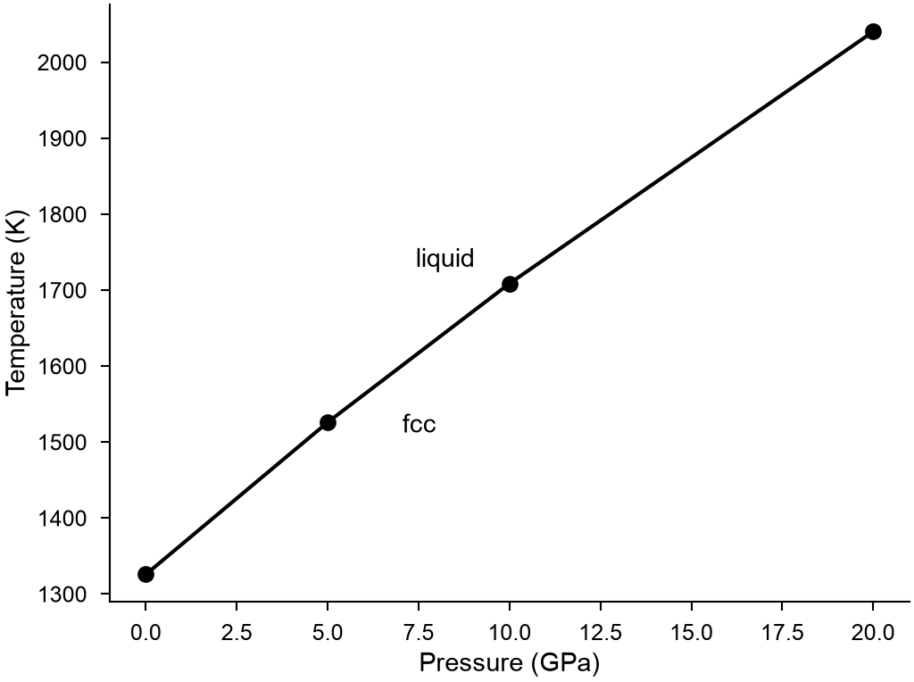

# Pressure-temperature diagrams

`mdapy.simulation.pressure_temperature_diagram(phases)` gives the phase diagram of one
element against pressure and temperature, from the [free energies](free-energy.md) of its
phases at each pressure: at each temperature the phase with the lowest free energy is the
stable one, and where this changes is a boundary.

<!-- skip-test -->
```python
import numpy as np
from mdapy.build import build_crystal
from mdapy.calculators import LAMMPS
from mdapy.simulation import free_energy, minimize, pressure_temperature_diagram
from mdapy.visualization import plot

potential = LAMMPS(
    "pair_style eam/alloy\npair_coeff * * Cu_mishin1.eam.alloy Cu", elements=["Cu"]
)
crystal = minimize(
    build_crystal("fcc", 3.615, elements="Cu", repeat=(16, 16, 16)),
    potential,
    cell="full",
    max_stress=1e-4,
).system

# around where each pressure melts, not too far above it: a crystal must stay a crystal
windows = {0.0: (1100, 1600), 5.0: (1400, 1700), 10.0: (1600, 1900), 20.0: (1900, 2250)}
options = dict(switching=100, scan=300, repeats=2)
solid, liquid = [], []
for pressure, (low, high) in windows.items():
    temperatures = np.arange(low, high + 1.0, 25.0)
    solid.append(
        free_energy(crystal, potential, temperatures, pressure=pressure, **options)
    )
    liquid.append(
        free_energy(
            crystal,
            potential,
            temperatures[::-1],
            phase="liquid",
            pressure=pressure,
            equilibration=15,
            **options,
        )
    )

diagram = pressure_temperature_diagram({"fcc": solid, "liquid": liquid})
melting = diagram.boundaries[0]
melting.temperatures, melting.slope  # K, K/GPa
diagram.phase_at(10.0, 1650.0), diagram.phase_at(10.0, 1800.0)  # "fcc", "liquid"

with plot.style():
    fig, ax = plot.figure("single")
    plot.pressure_temperature(diagram, ax=ax)
    plot.save(fig, "images/pressure-temperature", formats=("png",))
```



*The melting line of copper with the EAM potential of Mishin et al., 16384 atoms: 1326 K at
0 GPa, 1526 K at 5 GPa, 1709 K at 10 GPa and 2040 K at 20 GPa, with slopes of 43, 38, 35 and
31 K/GPa. The [two-phase method](melting-point.md) gives 1326, 1525, 1708 and 2035 K at
these pressures, with 16456 atoms.*

| Name | Type | Default | Unit | Meaning |
|---|---|---|---|---|
| `phases` | mapping | | | for each name of a phase, its free energies, one per pressure, each a `FreeEnergyResult` of a run at that pressure |
| `points` | int32 | 1001 |  | the temperatures of the diagram, from the lowest of the free energies to the highest |

Choose the temperatures of each pressure around its boundary. A crystal heated far above
its melting point melts during the scan, and [`free_energy`](free-energy.md) leaves those
temperatures out with a warning. A boundary is found along the temperature at each
pressure, so one that is nearly flat in temperature, as between two solids, needs pressures
close together. One run of a liquid has an error of about 0.25 meV/atom at 2048 atoms, which
is about 3 K here, so `repeats` matters more than a long scan.

## Results

It returns a `PressureTemperatureDiagram`; arrays are read-only.

| Attribute or method | Type | Unit | Meaning |
|---|---|---|---|
| `phases` | tuple of str | | the names of the phases |
| `pressures` | (P,) float64 | GPa | the pressures |
| `temperatures` | (T,) float64 | K | the temperatures |
| `stable` | (P, T) int64 |  | the index in `phases` of the phase with the lowest free energy of those known there, or -1 where none is |
| `boundaries` | tuple of `PhaseBoundary` | | each pair of phases in equilibrium |
| `phase_at(pressure, temperature)` | str or `None` | | the stable phase at the nearest pressure and temperature of the diagram |

A `PhaseBoundary`:

| Attribute | Type | Unit | Meaning |
|---|---|---|---|
| `first`, `second` | str | | the phases, the first stable below the temperature of the boundary and the second above it |
| `pressures` | (B,) float64 | GPa | the pressures |
| `temperatures` | (B,) float64 | K | the temperature of the boundary at each pressure |
| `latent_heat` | (B,) float64 | eV per atom | the change of enthalpy from the first to the second |
| `volume` | (B,) float64 | ų per atom | the change of volume from the first to the second |
| `slope` | (B,) float64 | K/GPa | $\mathrm{d}T/\mathrm{d}P$ by the Clausius-Clapeyron relation |

## Definition

At each pressure the stable phase has the lowest Gibbs free energy $G(T, P)$, and two
phases coexist where theirs are equal. Along such a boundary

$$
\frac{\mathrm{d}T}{\mathrm{d}P} = \frac{T \Delta V}{\Delta H},
$$

the Clausius-Clapeyron relation, with $\Delta V$ and $\Delta H$ the changes of the volume
and the enthalpy from one phase to the other.

`plot.pressure_temperature(result, *, ax=None, labels=True)` draws the boundaries, with the
names of the phases where each is stable.

## Errors

`pressure_temperature_diagram` raises `InvalidParameter` for fewer than two phases, too few
points, a free energy without a pressure, or two free energies of one phase at one pressure.

!!! quote "Please cite"
    [Freitas et al. (2016)](../../reference/references.md#freitas2016) for the free energies.
