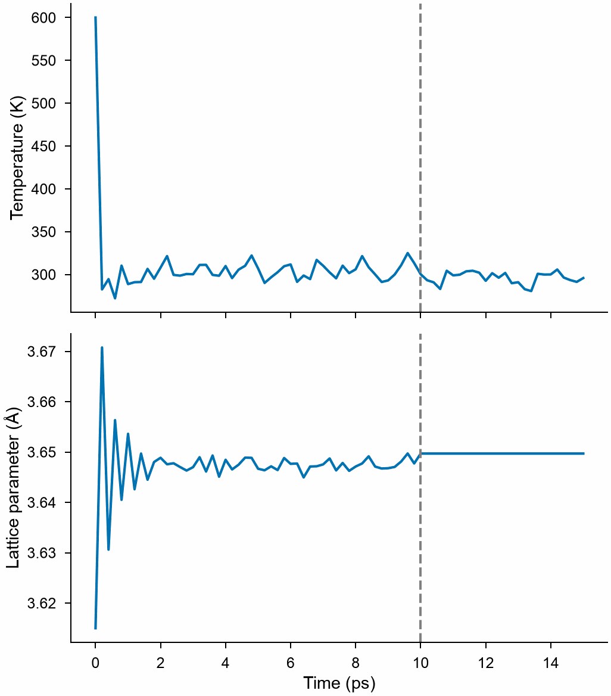

# Running molecular dynamics

<p class="runs-on" markdown>**Runs on** the processor · the [GPU](gpu.md) · [LAMMPS](in-lammps.md)</p>

`mdapy.simulation.MolecularDynamics(system, potential, *, timestep=0.001, log=None, beads=1)`
runs molecular dynamics of a system and gives back the thermodynamic state,
the atoms along the way and the system at the end. With any calculator of MDAPY,
such as [EAM](../potentials/eam.md), [NEP](../potentials/nep.md) or an
[ASE calculator](../interop/ase-calculators.md), it runs in MDAPY itself, on the
processor or, for a potential with `device="cuda"`, on an NVIDIA [GPU](gpu.md); with a
[LAMMPS calculator](../potentials/lammps.md) it runs [in LAMMPS](in-lammps.md). The
two take the same calls and give the same runs, step by step.
[A copper cluster melting](../../examples/cluster-melting.md) runs it from
start to end.

```python
from mdapy.build import build_crystal
from mdapy.calculators import EAM
from mdapy.simulation import MolecularDynamics

copper = EAM.zhou(["Cu"])
crystal = build_crystal("fcc", 3.615, elements="Cu", repeat=(6, 6, 6))  # 864 atoms

with MolecularDynamics(crystal, copper, timestep=0.002) as md:
    md.velocities(600, seed=1)
    md.run(5000, ensemble="npt", temperature=300, pressure=0.0, thermo=100)
    md.run(2500, ensemble="nvt", temperature=300, save_every=500)
    md.thermo  # polars DataFrame: step, time, temperature, energies, ...
    md.frames  # the atoms every 500 steps of the second run
    hot = md.system  # the atoms at the end, with velocities and images
```

The thermodynamic state along the two runs:

```python
from mdapy.visualization import plot

thermo = md.thermo
a = (thermo["volume"] / 216) ** (1 / 3)  # lattice parameter of the 6 x 6 x 6 cells
with plot.style():
    fig, (top, bottom) = plot.figure("single", 100, nrows=2, sharex=True)
    top.plot(thermo["time"], thermo["temperature"])
    top.set_ylabel("Temperature (K)")
    bottom.plot(thermo["time"], a)
    bottom.set_ylabel("Lattice parameter (Å)")
    bottom.set_xlabel("Time (ps)")
    for ax in (top, bottom):
        ax.axvline(10.0, color="0.5", linestyle="--")  # npt, then nvt
    plot.save(fig, "images/dynamics", formats=("png",))
```



*Copper started at 600 K: half the kinetic energy goes into the potential
energy at once, and the thermostat holds the rest at 300 K. The barostat
expands the box from the lattice parameter of 0 K, 3.615 Å, to that of 300 K at zero
pressure, 3.648 Å; after the dashed line the box is fixed (nvt).*

The same calls run a calculator that LAMMPS does not have, here a NEP model, or any
model with an ASE calculator, with no LAMMPS installed:

<!-- skip-test -->
```python
from mdapy.calculators import NEP

model = NEP("nep.txt")
small = build_crystal("fcc", 3.615, elements="Cu", repeat=(3, 3, 3))
with MolecularDynamics(small, model, timestep=0.002) as md:
    md.velocities(300, seed=1)
    md.run(5000, ensemble="nvt", temperature=300, thermostat="langevin", seed=2)
    md.run(5000, ensemble="npt", temperature=300, pressure=0.0, save_every=100)
```

On the processor it suits small systems, from a few atoms to some thousands, such as
those of the training sets of machine-learned potentials; with a potential on an NVIDIA
GPU the same dynamics runs there, for millions of atoms: see [On the GPU](gpu.md). Its
[controls](controls.md) hold, move, push, heat, deform, indent and shock the atoms, on
the processor and on the GPU alike. Large systems on many processors, and fixes beyond
these, are for LAMMPS.

A `movable` column, (N, 3) bool as VASP's selective dynamics, keeps atoms
still along the directions where it is False, in MDAPY's dynamics only; the
temperature then counts the directions in which the atoms move.

Along a box vector that is not periodic, atoms may leave the box, as a free surface
that expands or a cluster that evaporates; the dynamics keeps them. The box that a run
gives, in `system` and in the frames, grows to hold them, never smaller than the box
of `system`, with a room of 1e-4 of the vector, as LAMMPS's boundary `m` grows it; the
`volume` and the `pressure` of `thermo` are those of that box. Bins that stay where
they are, whatever the box, are [`SpatialBinning`](../analysis/spatial-binning.md#fixed-bins)'s
`bounds`.

## Parameters

| Name | Type | Default | Unit | Meaning |
|---|---|---|---|---|
| `system` | `System` | | | the atoms, with an `element` column (or, in MDAPY, a `mass` column), `velocities` in Å/ps when it has them, and a `movable` column (MDAPY only) |
| `potential` | calculator | | | the interaction: a `LAMMPS` calculator, run in LAMMPS, or any other calculator, run in MDAPY, which needs energies and forces, and the virial for a barostat |
| `timestep` | float64 | 0.001 | ps | the time step |
| `log` | str, path or stream | `None` | | writes the runs to this file, which it overwrites, or to this stream, such as `sys.stdout`: see [Log](records.md#log) |
| `beads` | int32 | 1 | | the beads of the ring polymer of each atom, for quantum nuclei: see [Path integrals](pimd.md) |

## Running

| Method or attribute | Meaning |
|---|---|
| `velocities(temperature, *, seed)` | random velocities of a temperature in K, Gaussian, with no total momentum; the same for the same seed and atoms, whatever their positions |
| `run(steps, *, ensemble="nve", temperature=None, pressure=None, barostat="iso", thermostat="nose-hoover", thermostat_damping=None, barostat_damping=None, seed=None, keep_momentum=False, hugoniot=None, shock_velocity=None, msst=None, thermo=100, save_every=None, controls=None, progress=None, cancel=None)` | runs `steps` steps |
| `iterate(steps, *, save_every, ...)`, the other parameters those of `run` | runs as `run` does, giving the atoms every `save_every` steps as the run reaches them and keeping none: see [Frames in files](records.md#frames-in-files) |
| `command(commands)` | runs any LAMMPS commands, one or several lines (LAMMPS only): see [In LAMMPS](in-lammps.md#lammps-commands) |
| `lammps` | the LAMMPS instance itself (LAMMPS only) |
| `close()` | closes the instance; leaving a `with` block closes it too |

| Parameter of `run` | Type | Default | Unit | Meaning |
|---|---|---|---|---|
| `ensemble` | str | `"nve"` | | `"nve"`, `"nvt"`, `"npt"` or `"nph"`, or for a shock `"nphug"` or `"msst"`: see [Ensembles](ensembles.md) |
| `temperature` | float64 or (float64, float64) | | K | the temperature of the thermostat, or its values at the start and end of the run; for `"nvt"` and `"npt"` |
| `pressure` | float64 or (float64, float64) | | GPa | the pressure of the barostat, or its values at the start and end; for `"npt"`, `"nph"` and `"nphug"`, which takes one value |
| `barostat` | str | `"iso"` | | how the box may change: `"iso"`, `"aniso"`, `"tri"`, `"xy"`, `"x"`, `"y"` or `"z"`: see [Barostats](ensembles.md#barostats) |
| `thermostat` | str | `"nose-hoover"` | | a chain of Nosé–Hoover thermostats, or `"langevin"` dynamics: see [Thermostats](ensembles.md#thermostats) |
| `thermostat_damping` | float64 | 100 time steps | ps | the damping time of the thermostat, positive; with beads `math.inf` leaves the centroids free: see [Path integrals](pimd.md#parameters) |
| `barostat_damping` | float64 | 1000 time steps | ps | the damping time of the barostat, positive |
| `seed` | int32 | `None` | | seed of the random forces of Langevin dynamics, positive (at most 900000000 in LAMMPS); unpredictable when `None` |
| `keep_momentum` | bool | `False` | | with Langevin dynamics, random forces that keep the total momentum: see [Thermostats](ensembles.md#thermostats) |
| `hugoniot`, `shock_velocity`, `msst` | | `None` | | for `"nphug"` and `"msst"`: see [Hugoniostat](hugoniostat.md#parameters) and [Multiscale shock technique](msst.md#parameters) |
| `thermo` | int32 | 100 | | records the thermodynamic state every this many steps, and at the start and the end |
| `save_every` | int32 | `None` | | keeps the atoms every this many steps, in `frames`; `iterate` gives them instead, and needs it |
| `controls` | sequence | `None` | | `Hold`, `Move`, `AddForce`, `Langevin`, `Deform`, `AdaptiveTimestep`, `Switch`, `Wall` or `Indenter`: what is done to groups of atoms, the box, the time step or the potential during the run, or the walls and indenters that push the atoms; see [Groups and controls](controls.md) |
| `progress` | callable | `None` | | called as `progress(done, total)` with the steps run |
| `cancel` | `CancelToken` | `None` | | stops the run, which raises `Cancelled` |

A run goes in pieces between the steps at which something is recorded; the
pieces run as one run would, a temperature or pressure changing from its
start to its end value across all of them. With Langevin dynamics and a
barostat, the barostat's mass is that of the temperature at the start.

## Starting velocities

The velocities of `system`, if it has them, are where the dynamics starts;
`thermal_velocities` gives a system those of a temperature, the same as
`velocities` gives in MDAPY with the same seed, to all its atoms or to a
part, the others still: a flyer of copper at 300 K that strikes the rest
at 1 km/s, 10 Å/ps,

```python
from mdapy.build import build_crystal
from mdapy.calculators import EAM
from mdapy.simulation import MolecularDynamics, thermal_velocities

crystal = build_crystal("fcc", 3.615, elements="Cu", repeat=(12, 4, 4))
flyer = crystal["positions"][:, 0] < 20.0
v = thermal_velocities(crystal, 300.0, seed=1, mask=flyer)
v[flyer, 0] += 10.0
with MolecularDynamics(crystal.with_columns(velocities=v), EAM.zhou(["Cu"])) as md:
    md.run(10)
```

| Parameter of `thermal_velocities` | Type | Default | Unit | Meaning |
|---|---|---|---|---|
| `system` | `System` | | | the atoms, with a `mass` or an `element` column; a `movable` column keeps them still along the directions where it is False, and then their total momentum is not removed |
| `temperature` | float64 | | K | the temperature, not negative |
| `seed` | int32 | | | seed of the random numbers, positive |
| `mask` | (N,) bool | every atom | | the atoms that get velocities, with no total momentum among them; the others get none |

It returns the (N, 3) float64 velocities in Å/ps: Gaussian, scaled so that
their kinetic energy is that of the temperature over 3n − 3 directions of
the n atoms of `mask`, or over those a `movable` column frees.

## Results

| Attribute | Type | Meaning |
|---|---|---|
| `system` | `System` | the atoms now, with `velocities` and `image` columns, the box, and `timestep` and `time` in `info`; the other columns of `system`, except forces and energies, which would be out of date |
| `thermo` | polars `DataFrame` | the thermodynamic state of all the runs so far, one row per record |
| `frames` | tuple of `System` | the atoms that `save_every` of `run` kept in all the runs so far, as `system` gives them |
| `step` | int64 | the time step number |

The columns of `thermo`, and those that ensembles and controls add, are in
[Records and frames](records.md#columns-of-thermo).

## Errors

`MolecularDynamics` raises `InvalidParameter` for a potential that is not a
calculator, a time step that is not positive, elements without an atom type
in LAMMPS, a `movable` column that holds atoms in LAMMPS, commands that
LAMMPS rejects, and a `log` that is neither a path nor a stream, or that
cannot be written; `MissingProperty` for a system without elements (or, in
MDAPY, without masses); `ImportError` without the LAMMPS Python module, for a
LAMMPS calculator. `velocities` and `thermal_velocities` raise `InvalidParameter` for a negative
temperature or a seed that is not positive, and `thermal_velocities` for a
mask that is not one bool for each atom and `MissingProperty` for a system
without masses or elements; `run` for a negative number of
steps, an unknown ensemble, barostat or thermostat, a damping that is not
positive, `thermostat_damping=math.inf` without beads, a thermostat without a
positive temperature, a barostat without a pressure, `"aniso"` or `"tri"` in
a box that is not periodic, `"xy"` in a box not periodic along its first two
vectors, `"x"`, `"y"` or `"z"` in a box not periodic along that axis or not
in the form of LAMMPS, `"nphug"` with two pressures, a temperature, Langevin
dynamics or controls, `"xy"` or a box that is not periodic, a `hugoniot`
that is not three numbers with a positive volume or that is given to another
ensemble, the errors of `"msst"` (see [Multiscale shock technique](msst.md#errors)),
`thermo`, `save_every` or `seed` that are not positive, a barostat
in MDAPY with a calculator without virials or, for `"nph"` and `"nphug"`,
atoms without a temperature, and a thermostat with no atom free to move; in MDAPY, it raises
`CalculationFailed` when the energy or the forces stop being finite. `command`
and `lammps` raise `InvalidParameter` in MDAPY, `command` for commands LAMMPS
rejects, and `lammps` after `close`. `iterate` raises what `run` raises, for
its options at once and for the rest as its frames are read, and
`InvalidParameter` without `save_every`; `run`, `iterate`, `velocities` and
`command` raise `InvalidParameter` while the frames of an `iterate` are
being read.

!!! quote "Please cite"
    For MDAPY's own dynamics:
    [Martyna et al. (1994)](../../reference/references.md#martyna1994),
    [Shinoda et al. (2004)](../../reference/references.md#shinoda2004)
    and [Tuckerman et al. (2006)](../../reference/references.md#tuckerman2006)
    for the thermostats and barostat;
    [Bussi and Parrinello (2007)](../../reference/references.md#bussi2007) for
    Langevin dynamics.
