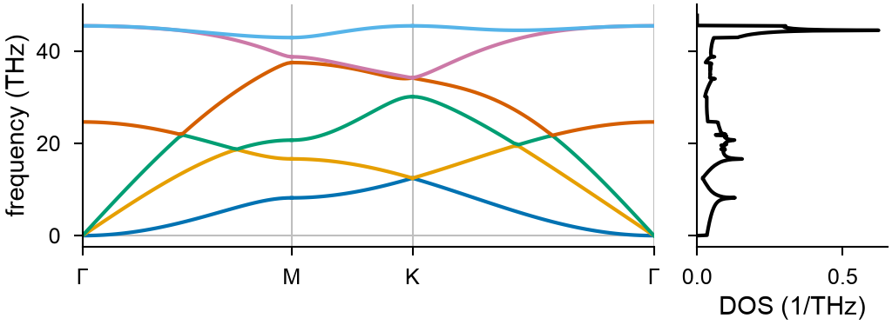

# Sheets

[Elastic constants](elastic-constants.md) and [phonons](phonons.md) of
two-dimensional materials such as graphene. A box that is periodic along two
vectors in the x-y plane and not along a third along z makes a system a sheet;
nothing else changes in the calls.

<!-- skip-test -->
```python
import mdapy
from mdapy.build import build_crystal
from mdapy.calculators import LAMMPS
from mdapy.lattice_dynamics import elastic_constants, phonons
from mdapy.simulation import minimize

potential = LAMMPS("pair_style lcbop\npair_coeff * * C.lcbop C", elements=["C"])
crystal = build_crystal("graphene", 2.46, c=20.0, elements="C")
sheet = crystal.with_box(mdapy.Box(crystal.box.matrix, pbc=(True, True, False)))
sheet = minimize(sheet, potential, cell="full", max_stress=1e-3).system

elastic = elastic_constants(sheet, potential)
elastic.constants  # (3, 3) N/m: 331, 73 and 129
elastic.young_modulus(), elastic.poisson_ratio()  # 315 N/m, 0.22

result = phonons(sheet, potential)
bands = result.band_structure("hexagonal")  # Γ-M-K-Γ
dos = result.dos(100)  # the mesh is 100 x 100 x 1
thermal = result.thermal([100, 300, 1000], mesh=100)  # F, E, S, C_V per atom
```

The phonons of graphene, drawn with the same calls as those of a crystal:

<!-- skip-test -->
```python
from mdapy.visualization import plot

with plot.style():
    fig, (left, right) = plot.figure(
        "single", ncols=2, sharey=True, width_ratios=[3, 1]
    )
    plot.band_structure(bands, ax=left)
    plot.phonon_dos(dos, ax=right)
    plot.save(fig, "images/sheets", formats=("png",))
```



*Graphene with the LCBOP potential of LAMMPS. The lowest branch near Γ, the
vibration across the sheet, is quadratic; the two above it are linear.*

The height of the box does not matter and the atoms need no vacuum around
them: a sheet has no images along z. A calculator that always takes the box as
periodic, such as [VASP](vasp.md), needs a box high enough that the images of
the sheet do not meet.

## Elastic constants

`elastic_constants` strains the sheet along xx, yy and xy only and returns a
`SheetElasticResult`, per unit of the area of the sheet, so that no thickness
has to be chosen. The parameters are those of
[`elastic_constants`](elastic-constants.md).

| Attribute or method | Type | Meaning |
|---|---|---|
| `constants` | (3, 3) float64 | elastic constants $C$ in N/m, in the order xx, yy, xy; read-only |
| `young_modulus(axis="x")` | float64 | the Young's modulus in N/m along `"x"` or `"y"` |
| `poisson_ratio(axis="x")` | float64 | the contraction across a stretch along `"x"` or `"y"`, over the stretch |
| `shear_modulus()` | float64 | the shear modulus in N/m |
| `area_modulus()` | float64 | the area modulus in N/m: the tension per unit of relative change of the area |

With $S = C^{-1}$ these are

$$
E_x = \frac{1}{S_{11}}, \quad E_y = \frac{1}{S_{22}}, \quad
\nu_x = -\frac{S_{12}}{S_{11}}, \quad \nu_y = -\frac{S_{12}}{S_{22}}, \quad
G = \frac{1}{S_{33}}, \quad K = \frac{1}{S_{11} + S_{22} + 2 S_{12}}.
$$

## Phonons

`phonons` takes the parameters and returns the `Phonons` of a crystal, with
these differences:

- `supercell` repeats the cell along its plane only: one integer means both
  vectors, three integers end in 1, and by default it is the supercell nearest
  a square at least twice the cutoff of the calculator wide;
- a `mesh` of one integer in `dos` and `thermal` means the plane, and three
  integers end in 1. The vibrations across the sheet make the thermal
  properties converge slowly with the mesh, so a mesh of 100 is a good start;
- the paths `"auto"` and `"hexagonal"` of `band_structure` keep the sections
  in the plane: Γ-M-K-Γ for a hexagonal sheet.

`primitive_cell` takes a sheet and gives the primitive cell of its plane, in a
box of the same height.

## In gigapascals

A sheet has no thickness of its own, so its constants are in N/m. With a thickness
$h$ chosen by convention, such as the 3.35 Å between the layers of graphite, the
constants of a material of that thickness are $C[\mathrm{GPa}] = 10\, C[\mathrm{N/m}]
/ h[\text{Å}]$: 331 N/m is 988 GPa.

## Molecular dynamics

[`MolecularDynamics`](dynamics.md) runs a sheet as it is. `barostat="xy"` controls the
pressure in the plane and keeps the height of the box:

<!-- skip-test -->
```python
from mdapy.simulation import MolecularDynamics

with MolecularDynamics(sheet, potential) as md:
    md.velocities(600.0, seed=1)
    md.run(20000, ensemble="npt", temperature=300.0, pressure=0.0, barostat="xy")
```

LAMMPS divides the forces by the volume of the box, with its vacuum. A tension of
$\sigma$ in N/m is therefore the pressure $-10\, \sigma / h$ GPa, with the height of the
box $h$ in Å; at zero pressure the height does not matter.

## Errors

`elastic_constants`, `phonons` and `primitive_cell` raise `InvalidParameter`
for a box that is not periodic in every direction and is not that of a sheet.
`phonons` raises it for a supercell that leaves the plane, `dos` and `thermal`
for a mesh with more than one wave vector along z. The methods of
`SheetElasticResult` raise it for an axis other than `"x"` or `"y"` and for
constants that cannot be inverted.

[`quasi_harmonic`](quasi-harmonic.md) and [elastic constants from molecular
dynamics](md-elastic.md) need a box periodic in every direction: a sheet has
no volume to scan. The moduli of `ElasticResult`, for a sheet in a periodic box
with vacuum, raise `InvalidParameter`, as its constants cannot be inverted.
