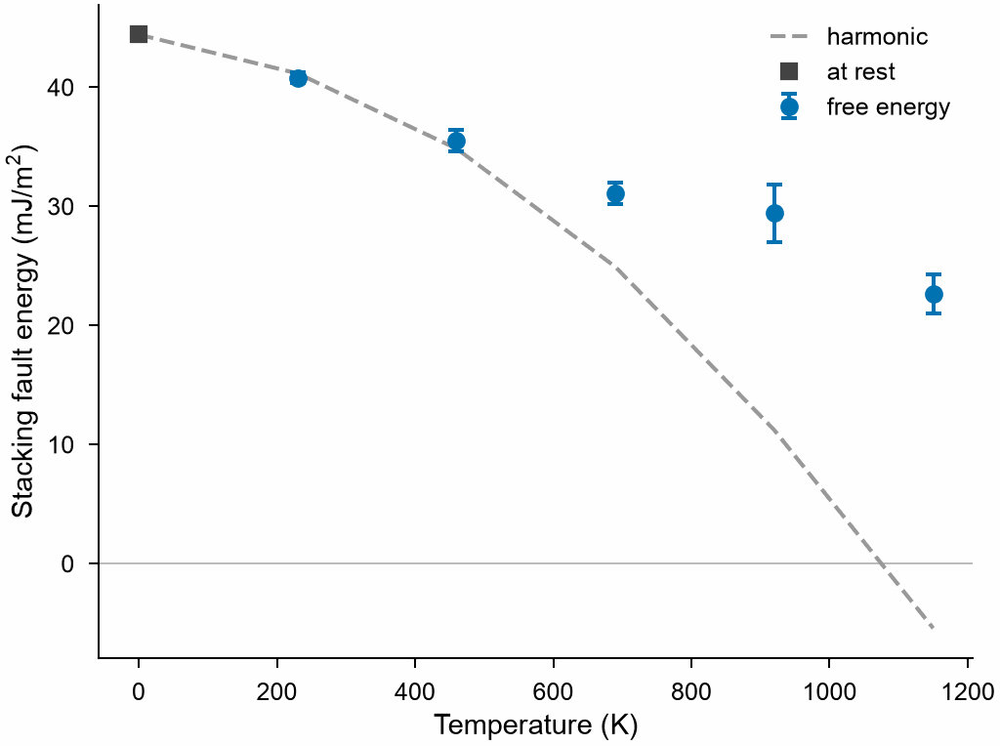

# Stacking faults at finite temperature

`mdapy.simulation.stacking_fault_free_energy(crystal, potential, direction,
temperatures)` gives the free energy of a stacking fault per area at each temperature:
the difference of the [free energies](free-energy.md) of the crystal with and without
it, in one box of the size the crystal has at that temperature and pressure. The
energy at rest is the business of
[`stacking_fault_energy`](defect-energies.md).

<!-- skip-test -->
```python
import numpy as np
from mdapy.build import build_crystal
from mdapy.calculators import LAMMPS
from mdapy.simulation import minimize, stacking_fault_free_energy

potential = LAMMPS(
    "pair_style eam/alloy\npair_coeff * * Cu_mishin1.eam.alloy Cu", elements=["Cu"]
)
a = 3.615
layers = minimize(
    build_crystal(
        "fcc",
        a,
        elements="Cu",
        orientation=[(1, 1, -2), (-1, 1, 0), (1, 1, 1)],
        repeat=(6, 10, 4),
    ),
    potential,
    cell="axes",  # keeps the plane normal to z, whatever the rounding of a potential
    max_stress=1e-3,
).system

result = stacking_fault_free_energy(
    layers,
    potential,
    [a * np.sqrt(6) / 6, 0, 0],  # 1/6 [11-2]
    [230, 460, 690, 920, 1150],
    repeats=8,
)
result.energy, result.error  # J/m²
```

The harmonic part of the same difference, for comparison: classical atoms in the
[phonons](phonons.md) of a perfect and a faulted cell of 24 (111) layers, each at the
volume per atom of the crystal at that temperature. The free energy of the vibrations
of classical atoms is $k_BT\sum\ln(h\nu/k_BT)$ over the modes, so the difference of
two cells of as many atoms is $k_BT$ times the difference of their sums of $\ln\nu$,
here averaged over a mesh of wave vectors that misses Γ. At 0 K only the static part is
left, the fault at rest:

<!-- skip-test -->
```python
from mdapy import units
from mdapy.build import slip
from mdapy.lattice_dynamics import phonons

grid = (np.arange(10) + 0.5) / 10
mesh = [[x, y, z] for x in grid for y in grid for z in (0.25, 0.75)]
harmonic = []
for temperature, volume in zip([0, *result.temperatures], [a**3 / 4, *result.volume]):
    side = (4 * volume) ** (1 / 3)  # the lattice constant at this temperature
    perfect = build_crystal(
        "fcc",
        side,
        elements="Cu",
        orientation=[(1, 1, -2), (-1, 1, 0), (1, 1, 1)],
        repeat=(1, 1, 8),
    )
    faulted = slip(perfect, [side * np.sqrt(6) / 6, 0, 0])  # the box tilts with it
    energy, logs = [], []
    for cell in (perfect, faulted):
        cell = minimize(cell, potential, max_force=1e-5).system
        frequencies = phonons(cell, potential, supercell=(4, 7, 1)).frequencies(mesh)
        energy.append(potential.compute(cell).energy)
        logs.append(np.log(frequencies).sum(axis=1).mean())
    kt = units.BOLTZMANN * temperature
    area = perfect.box.matrix[0, 0] * perfect.box.matrix[1, 1]
    difference = energy[1] - energy[0] + kt * (logs[1] - logs[0])
    harmonic.append(difference / area * units.EV_PER_A2_TO_J_PER_M2)
```

The fault gets cheaper with the temperature:

<!-- skip-test -->
```python
from mdapy.visualization import plot

with plot.style():
    fig, ax = plot.figure("single")
    every = [0, *result.temperatures]
    ax.plot(every, 1e3 * np.array(harmonic), "--", color="0.6", label="harmonic")
    ax.plot(0, 1e3 * harmonic[0], "s", color="0.25", label="at rest")
    ax.errorbar(
        result.temperatures,
        1e3 * result.energy,
        1e3 * result.error,
        fmt="o",
        capsize=2,
        label="free energy",
    )
    ax.axhline(0.0, color="0.75", lw=0.5, zorder=0)
    ax.set_xlabel("Temperature (K)")
    ax.set_ylabel(r"Stacking fault energy (mJ/m$^2$)")
    ax.legend()
    plot.save(fig, "images/stacking-fault-temperature", formats=("png",))
```



*Copper with the EAM potential of Mishin et al., 1440 atoms and a plane of 684 Ų,
44 mJ/m² at rest. Up to about 500 K the free energy follows the harmonic part; above
that it falls more slowly: 23 mJ/m² against -5 mJ/m² at 1150 K. The harmonic part
leaves out the anharmonic vibrations, which the switching of the free energy takes in.*

The wider the plane the smaller the error: the error of the free energy of all atoms
grows with their square root, the free energy of the fault with the area. The error
also grows towards the melting point, where 192 atoms of this copper gave ±33 mJ/m² at
1250 K against ±7 mJ/m² at 1040 K: look at `error` and `dissipation`. The crystal must
keep its fault during the runs: a slip vector that leads to no minimum of the
energy, as a partial in a potential with no stable stacking fault, slides back, and
gives something lower than the energy at rest.

| Name | Type | Default | Unit | Meaning |
|---|---|---|---|---|
| `crystal` | `System` | | | the crystal, relaxed, with an `element` column, periodic in every direction, with the plane of the fault normal to the Cartesian axis of `axis`, such as fcc with z along [111] |
| `potential` | `LAMMPS` | | | the interaction |
| `direction` | (3,) float64 | | Å | (3,) the slip vector in the plane, such as a/6 [11-2] |
| `temperatures` | float64 or (T,) float64 | | K | the temperatures |
| `height` | float64 | between the two layers nearest the middle | | the fault, as a fractional coordinate along the box vector of `axis` |
| `axis` | int32 or str | `z` | | the Cartesian axis normal to the fault |
| `pressure` | float64 | 0 | GPa | the pressure |
| `timestep` | float64 | 0.001 | ps | the time step |
| `equilibration` | float64 | 10 | ps | the time of each equilibration |
| `switching` | float64 | 50 | ps | the time of each switching between the crystal and the springs |
| `repeats` | int32 | 4 | | independent free energies of each crystal at each temperature |
| `max_force` | float64 | 1e-4 | eV/Å | convergence of the relaxation of the fault at each size of the box |
| `max_steps` | int32 | 10000 | | the largest number of steps of each relaxation |
| `seed` | int32 | 1 | | the seed of the random numbers |
| `progress` | callable | `None` | | called as `progress(done, total)` with the steps run |
| `cancel` | `CancelToken` | `None` | | stops the calculation, which raises `Cancelled` |

## Results

It returns a `FaultFreeEnergyResult`; arrays are read-only.

| Attribute | Type | Unit | Meaning |
|---|---|---|---|
| `temperatures` | (T,) float64 | K | the temperatures |
| `energy` | (T,) float64 | J/m² | the free energy of the fault per area |
| `error` | (T,) float64 | J/m² | its standard error from the repeats; zero for one repeat |
| `area` | float64 | Ų | the area of the fault at the first temperature |
| `volume` | (T,) float64 | ų | the volume per atom of the crystal |
| `dissipation` | (T,) float64 | eV | half the difference of the work there and back per atom, the largest over the runs |

## Definition

$$
\gamma(T) = \frac{F_\mathrm{fault}(T) - F_\mathrm{crystal}(T)}{A},
$$

where both free energies are those of [`free_energy`](free-energy.md) for solids, of
the same atoms in one box but for the box vector that the fault tilts. Classical atoms,
as in molecular dynamics. With the phonons of the two cells, the
[harmonic part](phonons.md) of this difference is cheaper and free of noise, but it
gets worse with the temperature.

## Errors

`stacking_fault_free_energy` raises `InvalidParameter` for invalid options, a plane not
normal to the axis, a box not periodic in every direction, or if LAMMPS fails;
`MissingProperty` for a crystal without an `element` column; `Cancelled` when
cancelled.

!!! quote "Please cite"
    [Frenkel and Ladd (1984)](../../reference/references.md#frenkel1984) and
    [Freitas et al. (2016)](../../reference/references.md#freitas2016) for the free
    energies; see also [Zhang et al. (2018)](../../reference/references.md#zhang2018) on
    stacking faults at high temperature.
