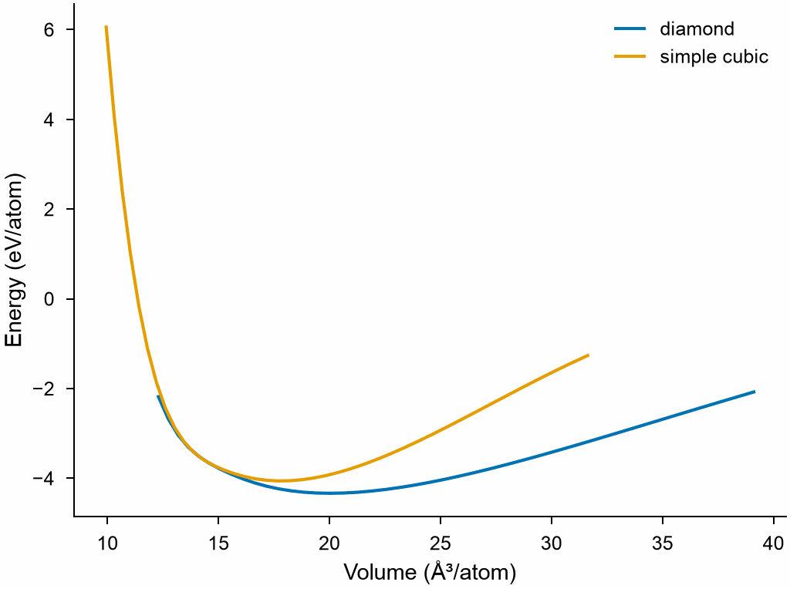

# Stillinger–Weber

```python
from pathlib import Path

from mdapy.calculators import StillingerWeber

# silicon of Stillinger and Weber (1985), as a line of a .sw file of LAMMPS:
# epsilon sigma a lambda gamma cos(theta0) A B p q tol
Path("Si.sw").write_text(
    "Si Si Si 2.1683 2.0951 1.80 21.0 1.20 -0.333333333333 7.049556277 0.6022245584 4.0 0.0 0.0\n"
)
potential = StillingerWeber("Si.sw")
potential.elements, potential.cutoff
```

The energy of silicon in the diamond and the simple cubic crystal against the
volume of an atom:

```python
import numpy as np
from mdapy.build import build_crystal
from mdapy.visualization import plot

scale = np.linspace(0.85, 1.25, 41)
with plot.style():
    fig, ax = plot.figure("single")
    for structure, a, label in (
        ("diamond", 5.431, "diamond"),
        ("sc", 2.53, "simple cubic"),
    ):
        cell = build_crystal(structure, a, elements="Si")
        cells = [
            cell.with_box(cell.box.matrix * s, scale_positions=True) for s in scale
        ]
        energy = [potential.compute(c, ("energy",)).energy / len(c) for c in cells]
        volume = [c.box.volume / len(c) for c in cells]
        ax.plot(volume, energy, label=label)
    ax.set_xlabel("Volume (ų/atom)")
    ax.set_ylabel("Energy (eV/atom)")
    ax.legend()
    plot.save(fig, "images/stillinger-weber", formats=("png",))
```



*Silicon of the Stillinger–Weber potential: the diamond crystal is the most
stable, at 4.34 eV per atom and 20.0 ų, its tetrahedral angles favored by
the three-body term.*

`StillingerWeber(path, elements=None)` reads a potential file of
`pair_style sw` of LAMMPS, in metal units, and computes it as LAMMPS does. The
energy is a sum of pairs and of the angles of each atom with two of its
neighbors:

$$
E = \sum_i \sum_{j > i} \phi_2(r_{ij}) + \sum_i \sum_{j \neq i} \sum_{k > j} \phi_3(r_{ij}, r_{ik}, \theta_{jik})
$$

$$
\phi_2(r) = A \varepsilon \left[ B \left( \frac{\sigma}{r} \right)^p - \left( \frac{\sigma}{r} \right)^q \right] e^{\sigma / (r - a \sigma)},
\qquad
\phi_3 = \lambda \varepsilon \left( \cos\theta_{jik} - \cos\theta_0 \right)^2
e^{\gamma \sigma / (r_{ij} - a \sigma)} e^{\gamma \sigma / (r_{ik} - a \sigma)}
$$

both zero beyond a σ.

## Parameters

| Parameter | Type | Meaning |
|---|---|---|
| `path` | str or path-like | a `.sw` file: for each triplet of elements i, j, k, the 11 numbers ε, σ, a, λ, γ, cos θ0, A, B, p, q and tol, over one or more lines |
| `elements` | sequence of str, or mapping | the elements to use, as the names after the file in `pair_coeff` of LAMMPS; every triplet of them needs an entry. A mapping takes the element of the atoms to a label of the file. Default every element of the file |

| Attribute | Type | Meaning |
|---|---|---|
| `path` | str | the potential file |
| `elements` | tuple of str | the elements of the potential |
| `cutoff` | float64 | the largest radius of a pair in Å: a σ, or less where tol is given |

The pair i–j takes ε, σ, a, A, B, p, q and tol of the entry i j j; the angle
j–i–k, λ and cos θ0 of the entry i j k, and γ, σ and a of i j j and i k k for
its two arms. A tol above zero ends each pair where its energy falls below
tol, as LAMMPS does, at most 0.01. The energy and the virial of a pair are
shared equally between its two atoms, and those of an angle among its three
atoms.

**Entries that disagree.** The angle j–i–k is in the entries i j k and
i k j, and the pair i–j in i j j and j i i. LAMMPS takes one of them by the
order of the neighbors or the numbering of the atoms, so that its results
depend on them when the entries differ, as in `CdTeZnSeHgS0.sw` of LAMMPS by
1e-8. MDAPY takes their mean; when they agree, the results are those of
LAMMPS.

The `threebody off` keyword and the styles `sw/mod` and `sw/angle/table` of
LAMMPS are not part of `StillingerWeber`.

## Errors

`StillingerWeber` raises `InvalidParameter` for a file that cannot be read,
is in other units than metal, or whose values are not entries of 14; an entry
with a word for a number, numbers that are not finite or negative parameters
but cos θ0; two entries of one triplet; a missing triplet of the elements
used; elements that are not in the file, named twice, or labels that are not
elements and are not mapped; and atoms of an element it has no entries for.

!!! quote "Please cite"
    [Stillinger and Weber (1985)](../../reference/references.md#stillinger1985), and the paper of the parameters.
