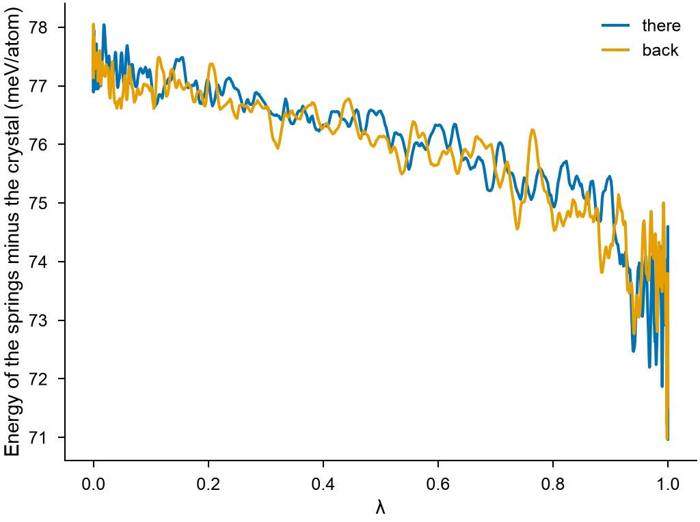

# Switching between potentials

`Switch`, a [control](controls.md) of a run of [molecular dynamics](dynamics.md) in
MDAPY, turns the potential of the run into another along the run: the forces are
those of $(1-\lambda) U + \lambda U_\mathrm{target}$, and $\lambda$ goes from 0 to 1,
or back. The mean of $U_\mathrm{target} - U$ over the way is the difference of the
free energies of the two, as [`free_energy`](free-energy.md) takes it, from a solid to
an Einstein crystal of [`Springs`](#springs) or from a liquid to the
[Uhlenbeck–Ford model](pair-potentials.md#the-uhlenbeckford-model).

Solid argon at 40 K switched to springs at the places of its atoms in 20 ps, and
back, at the temperature of a Langevin thermostat that keeps the momentum, so that
the crystal does not drift away from its springs:

```python
import numpy as np

from mdapy.build import build_crystal
from mdapy.calculators import LennardJones, Springs
from mdapy.simulation import MolecularDynamics, Switch, minimize

argon = LennardJones({"Ar": (0.0104, 3.4)}, 8.5, shift=True)
crystal = minimize(
    build_crystal("fcc", 5.26, elements="Ar", repeat=3),
    argon,
    cell="full",
    max_stress=1e-4,
).system
springs = Springs(crystal["positions"], 0.2)  # eV/Ų, tied to the places of the atoms
langevin = dict(
    ensemble="nvt",
    temperature=40.0,
    thermostat="langevin",
    thermostat_damping=0.1,
    keep_momentum=True,
)
paths = {}
with MolecularDynamics(crystal, argon, timestep=0.002) as md:
    md.velocities(80.0, seed=1)
    md.run(2000, seed=2, **langevin)
    for name, (start, stop), seed in (
        ("there", (0.0, 1.0), 3),
        ("back", (1.0, 0.0), 5),
    ):
        first = len(md.thermo)
        switch = Switch(springs, start=start, stop=stop, name="fl")
        md.run(10000, thermo=10, seed=seed, controls=switch, **langevin)
        rows = md.thermo[first:]
        paths[name] = (rows["fl_lambda"].to_numpy(), rows["fl_difference"].to_numpy())
        md.run(
            2000,
            seed=seed + 1,
            controls=Switch(springs, start=stop, stop=stop),
            **langevin,
        )

n = len(crystal)
there = np.trapezoid(paths["there"][1], paths["there"][0]) / n
back = np.trapezoid(paths["back"][1], paths["back"][0]) / n
0.5 * (there - back), 0.5 * (there + back)  # 0.0760 eV per atom, and 5e-5 eV lost
```

Half the difference of the two integrals is the free energy of the springs less that
of the crystal; half their sum, the heat lost on the way, is small when the switching
is slow enough:

```python
from mdapy.visualization import plot

with plot.style():
    fig, ax = plot.figure("single")
    for name, (lam, difference) in paths.items():
        ax.plot(lam, difference / n * 1000, label=name)
    ax.set(xlabel="λ", ylabel="Energy of the springs minus the crystal (meV/atom)")
    ax.legend()
    plot.save(fig, "images/switching", formats=("png",))
```



*The difference of the energies of the springs and of the crystal of argon at 40 K
against λ, from the crystal to the springs and back: the two ways meet, as the
switching is slow enough for the atoms to follow.*

## Switch

`Switch(target, *, start=0.0, stop=1.0, name=None)`, given to `run` or `iterate` by
`controls`.

| Parameter | Type | Default | Meaning |
|---|---|---|---|
| `target` | `Calculator` or `None` | | the other interaction, such as `Springs` or `UhlenbeckFord`; `None` for none, the ideal gas |
| `start` | float64 | 0.0 | λ at the start of the run, from 0 to 1 |
| `stop` | float64 | 1.0 | λ at the end of the run, from 0 to 1 |
| `name` | str | `None` | a word: `thermo` records `<name>_lambda` and `<name>_difference` |

- λ goes from `start` to `stop` by the switching function of LAMMPS's `fix ti/spring`
  with `function 2`, $\lambda = s(t)$ of the part $t$ of the run done, where
  $s(t) = t^5 (70 t^4 - 315 t^3 + 540 t^2 - 420 t + 126)$, which leaves and reaches its
  ends with zero slope; λ stays at `start` when the two are equal. It is set at the
  start of each step.
- The forces, the energy and the virial are those of $(1-\lambda)$ times the potential
  of the run and λ times the target; a target that computes no virial, as `Springs`,
  adds none, as `fix ti/spring` adds none in LAMMPS. `potential_energy` of `thermo` is
  that of the mixture.
- `<name>_lambda` is λ, and `<name>_difference` the energy of the target less that of
  the potential in eV, both unscaled, at each record: their integral over λ along a
  slow run is the difference of the free energies of the two.
- A `Switch` runs in MDAPY, on the processor. The runs are those of LAMMPS step by
  step: with an Uhlenbeck–Ford target, `pair_style hybrid/scaled` with λ a variable of
  the step; with `Springs`, `fix ti/spring` with `function 2`.

## Springs

`mdapy.calculators.Springs(sites, constants)` ties each atom to its own site by a
harmonic spring, $E = k |\mathbf{x} - \mathbf{x}_0|^2 / 2$, the displacement taken to
the nearest image of the site across the periodic directions: an Einstein crystal,
whose free energy is known.

| Parameter | Type | Unit | Meaning |
|---|---|---|---|
| `sites` | (N, 3) float64 | Å | the site of each atom, in the order of the atoms |
| `constants` | float64 or (N,) float64 | eV/Ų | the spring constant of every atom, or of each, positive |

It computes `energy`, `atomic_energies` and `forces`, and no virial.

## Errors

`Switch` raises `InvalidParameter` for a target that is neither a calculator nor
`None`, and a `start` or `stop` outside 0 to 1; `run` and `iterate` raise it for two
`Switch` in one run, a barostat with a target that computes no virial, a `Switch` in
LAMMPS or on the GPU, and two controls of one name. `Springs` raises it for sites that
are not (N, 3) finite numbers, constants that are not positive, and a system of
another number of atoms.

!!! quote "Please cite"
    [Frenkel and Ladd (1984)](../../reference/references.md#frenkel1984) and
    [Freitas et al. (2016)](../../reference/references.md#freitas2016) for switching
    to springs.
