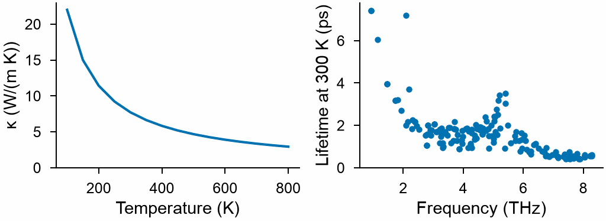

<!-- needs: spglib -->

# Thermal conductivity

`mdapy.lattice_dynamics.thermal_conductivity(constants, temperatures, *, mesh, sigma=None, symmetry=None)`
gives the lattice thermal conductivity of a crystal in the relaxation-time approximation:
the heat that phonons carry, each mode until three-phonon scattering ends it, from the
second and third order [force constants](force-constants.md).

```python
import numpy as np
from mdapy.build import build_crystal
from mdapy.calculators import EAM
from mdapy.lattice_dynamics import (
    displaced_supercells,
    force_constants,
    primitive_cell,
    thermal_conductivity,
)
from mdapy.simulation import minimize

potential = EAM.zhou(["Cu"])
crystal = minimize(
    build_crystal("fcc", 3.615, elements="Cu"), potential, cell="full", max_stress=1e-4
).system
cell = primitive_cell(crystal)
moved = displaced_supercells(cell, supercell=4, method="random", count=2, seed=1)
frames = [
    s.with_columns(forces=potential.compute(s, ("forces",)).forces) for s in moved
]
constants = force_constants(cell, frames, cutoff_third=4.5)  # three shells

temperatures = np.arange(100.0, 801.0, 50.0)
result = thermal_conductivity(constants, temperatures, mesh=11)
result.kappa[:, 0, 0]  # W/(m K): 22.0 at 100 K, 7.7 at 300 K
```

The conductivity of copper with `EAM.zhou`, and the lifetimes of its phonons at 300 K:

```python
from mdapy.visualization import plot

with plot.style():
    fig, (left, right) = plot.figure("single", ncols=2)
    left.plot(temperatures, result.kappa[:, 0, 0])
    left.set(xlabel="Temperature (K)", ylabel="κ (W/(m K))", ylim=(0, None))
    at = list(temperatures).index(300.0)
    right.scatter(result.frequencies, result.lifetimes[at], s=4)
    right.set(xlabel="Frequency (THz)", ylabel="Lifetime at 300 K (ps)", ylim=(0, None))
    plot.save(fig, "images/thermal-conductivity", formats=("png",))
```



*The phonon thermal conductivity of copper with `EAM.zhou`, falling as 1/T above the
Debye temperature, and the lifetimes of the modes of the irreducible wave vectors at
300 K, the shortest at the highest frequencies.*

| Name | Type | Default | Unit | Meaning |
|---|---|---|---|---|
| `constants` | `ForceConstants` | | | second and third order force constants of a crystal periodic in every direction, each atom with an element or a mass, such as those of [`force_constants`](force-constants.md) with `cutoff_third` |
| `temperatures` | float64 or (T,) float64 | | K | the temperatures, positive |
| `mesh` | int32 or (3,) int32 | | | the number of wave vectors along each reciprocal lattice vector, of a mesh through Γ |
| `sigma` | float64 or `None` | `None` | THz | the width of a Gaussian that stands for the conservation of energy in each scattering; by default the linear tetrahedron method |
| `symmetry` | bool or `None` | `None` | | compute the irreducible wave vectors only and average the group velocities with the rotations of the crystal, found by [spglib](../analysis/space-group.md): `True`, `False`, or by default whenever spglib is installed |

**Conservation of energy.** Each scattering conserves energy, and on a mesh of wave
vectors the delta functions that say so are spread. By default they are integrated over
linear tetrahedra between the points of the mesh: the 24 that share each point, cut
along the shortest main diagonal of the cells of the mesh, and those of every rotation
of the crystal, so that the result keeps its symmetry; the weights of modes of one
frequency are their mean, which does not depend on how the polarization vectors of such
modes come out ([Togo et al. (2015)](../../reference/references.md#togo2015)). With
`sigma`, each delta function is a Gaussian of that width instead, faster but too narrow
on a coarse mesh, where few scatterings meet it: for copper at 300 K, a Gaussian of
0.1 THz gives 222 W/(m K) on a mesh of 5 where the tetrahedra give 8.6, and 8.1 on a mesh
of 7 where they give 7.4.

**Converging.** The conductivity depends on three choices, each to converge:

- `cutoff_third`, the reach of the third order: for copper at 300 K on a mesh of 11,
  12.0 W/(m K) with the nearest neighbors, 11.6 with two shells, 7.67 with three (4.5 Å)
  and 7.71 within 6 Å, in 5 × 5 × 5 primitive cells;
- the supercell of the force constants: 7.72 in 4 × 4 × 4 primitive cells, 7.67 in
  5 × 5 × 5;
- `mesh`: 7.72 with 11 wave vectors along each vector, 7.89 with 15 and 7.96 with 19.

The time grows with the number of irreducible wave vectors times that of the whole
mesh, and as the fourth power of the number of modes of the cell: copper takes 4 s on
a mesh of 11, 22 s on 15.

The conductivity is that of the phonons alone. In a metal such as copper the
electrons carry most of the heat, about 400 W/(m K), which this does not hold.

Without symmetry, time reversal still pairs q with −q. The group velocities of modes of
the same frequency are then those of one basis of their space and are not averaged, so
the conductivity of a coarse mesh can stray from the symmetry of the crystal; spglib
removes that.

## Results

`thermal_conductivity` returns a `ThermalConductivity`, with the modes of the
irreducible wave vectors of the mesh.

| Attribute | Type | Unit | Meaning |
|---|---|---|---|
| `temperatures` | (T,) float64 | K | the temperatures |
| `kappa` | (T, 3, 3) float64 | W/(m K) | the thermal conductivity |
| `q` | (Q, 3) float64 | | the irreducible wave vectors, in units of the reciprocal lattice vectors of the cell |
| `weights` | (Q,) int64 | | the number of wave vectors of the mesh that each stands for |
| `frequencies` | (Q, 3n) float64 | THz | the frequencies |
| `group_velocities` | (Q, 3n, 3) float64 | Å/ps | the group velocities, as [`Phonons.group_velocities`](phonons.md#results) gives them |
| `gamma` | (T, Q, 3n) float64 | THz | the imaginary part of the self energy of each mode by three-phonon scattering, half its linewidth |
| `lifetimes` | (T, Q, 3n) float64 | ps | 1/(4π `gamma`); infinite for modes that do not scatter, which carry no heat here |
| `heat_capacities` | (T, Q, 3n) float64 | eV/K | the heat capacity of each mode |

Every attribute is read-only.

## Errors

`thermal_conductivity` raises `InvalidParameter` for force constants without third
order, a box that is not periodic in every direction, an atom with neither element nor
mass, a temperature that is not positive, a mesh that is not positive integers, a
`sigma` that is not positive, and `symmetry=True` without spglib.

## Definition

A mode λ = (**q**, s) of frequency ω<sub>λ</sub> scatters with two others, λ′ and λ″,
with **q** = **q**′ + **q**″ up to a reciprocal lattice vector, at the rate

$$
\Gamma_\lambda = \frac{18\pi}{\hbar^2} \sum_{\lambda'\lambda''}
\left|\Phi_{-\lambda\lambda'\lambda''}\right|^2
\Big[(n_{\lambda'} + n_{\lambda''} + 1)\,\delta(\omega_\lambda - \omega_{\lambda'} - \omega_{\lambda''})
+ (n_{\lambda'} - n_{\lambda''})\big(\delta(\omega_\lambda + \omega_{\lambda'} - \omega_{\lambda''})
- \delta(\omega_\lambda - \omega_{\lambda'} + \omega_{\lambda''})\big)\Big],
$$

with $n$ the Bose–Einstein occupations at the temperature, each δ integrated over the
tetrahedra of the mesh or a Gaussian of width `sigma`, and

$$
\Phi_{\lambda\lambda'\lambda''} = \frac{1}{\sqrt N}\frac{1}{3!}
\sum_{a\alpha, b\beta, c\gamma} \Psi_{a\alpha, b\beta, c\gamma}
\frac{e_{a\alpha}(\lambda)\, e_{b\beta}(\lambda')\, e_{c\gamma}(\lambda'')}
{\sqrt{m_a m_b m_c}}
\sqrt{\frac{\hbar^3}{8\,\omega_\lambda\omega_{\lambda'}\omega_{\lambda''}}}\;
e^{i(\mathbf q'\cdot\mathbf r_{ab} + \mathbf q''\cdot\mathbf r_{ac})},
$$

the third order force constants Ψ of an atom $a$ of the cell and atoms $b$ and $c$ of
the crystal, at the shortest images of their pairs, and $N$ the number of wave vectors
of the mesh ([Togo et al. (2015)](../../reference/references.md#togo2015)). `gamma` is
Γ<sub>λ</sub>/2π, the lifetime is τ<sub>λ</sub> = 1/(2Γ<sub>λ</sub>), and modes of the
same frequency share their mean Γ. The conductivity is

$$
\kappa_{\alpha\beta} = \frac{1}{N V} \sum_\lambda C_\lambda\,
v_{\lambda\alpha} v_{\lambda\beta}\, \tau_\lambda ,
$$

with $V$ the volume of the cell, $C_\lambda$ the heat capacity of the mode and **v** its
group velocity, summed over the irreducible wave vectors with their weights and $v_\alpha
v_\beta$ averaged over the rotations of the crystal
([Togo et al. (2023)](../../reference/references.md#togo2023)).

!!! quote "Please cite"

    [Togo et al. (2015)](../../reference/references.md#togo2015), whose method this
    follows.
