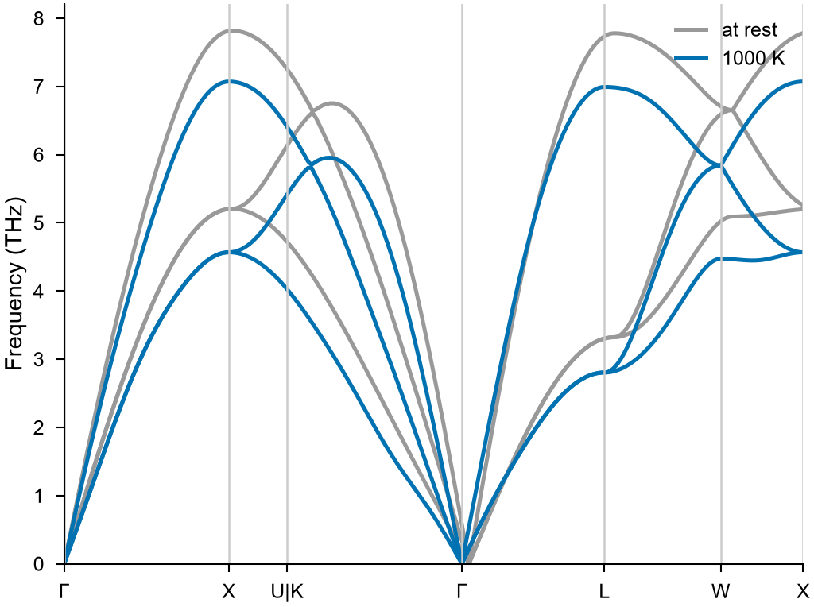

# Phonons at finite temperature

`mdapy.lattice_dynamics.thermal_phonons(cell, potential, temperature)` gives the
phonons of a crystal at a temperature from molecular dynamics in
[LAMMPS](lammps.md): the force constants that best give the forces on the moving
atoms. They hold what [harmonic phonons](phonons.md) leave out: the vibrations
feel the crystal away from its minimum, and the box has the size it has at that
temperature. `phonons_from_frames` does the same with frames from any dynamics,
such as *ab initio* molecular dynamics.

<!-- skip-test -->
```python
import numpy as np

from mdapy.build import build_crystal
from mdapy.calculators import LAMMPS
from mdapy.lattice_dynamics import phonons, primitive_cell, thermal_phonons
from mdapy.simulation import minimize

potential = LAMMPS(
    "pair_style eam/alloy\npair_coeff * * Cu_mishin1.eam.alloy Cu", elements=["Cu"]
)
crystal = minimize(
    build_crystal("fcc", 3.615, elements="Cu"), potential, cell="full", max_stress=1e-4
).system
cell = primitive_cell(crystal)

cold = phonons(cell, potential)
hot = thermal_phonons(cell, potential, 1000.0)  # a Phonons, as phonons gives
hot.band_structure("fcc")
hot.dos(20)
hot.thermal([1000.0])
```

The result is a [`Phonons`](phonons.md#results): its frequencies, band structures,
densities of states and thermal properties are read as those of harmonic phonons.

The bands of copper at rest and hot:

<!-- skip-test -->
```python
from mdapy.visualization import plot

with plot.style():
    fig, ax = plot.figure("single")
    for result, name, color in ((cold, "at rest", "0.6"), (hot, "1000 K", "#0072B2")):
        bands = result.band_structure("fcc")
        lines = ax.plot(bands.distances, bands.frequencies, color=color, lw=1.2)
        lines[0].set_label(name)
    ax.set_xticks([d for d, _ in bands.labels], [label for _, label in bands.labels])
    for d, _ in bands.labels:
        ax.axvline(d, color="0.8", lw=0.6)
    ax.set_xlim(bands.distances[0], bands.distances[-1])
    ax.set_ylim(0, None)
    ax.set_ylabel("Frequency (THz)")
    ax.legend(frameon=False, loc="upper right")
    plot.save(fig, "images/thermal-phonons", formats=("png",))
```



*Copper with the EAM potential of Mishin et al.: the bands at rest, and at 1000 K,
softer by 10 to 15 %, as the crystal has expanded and the atoms feel their
neighbors further from where they rest.*

| Name | Type | Default | Unit | Meaning |
|---|---|---|---|---|
| `cell` | `System` | | | the cell of the crystal, relaxed, periodic in every direction, with an `element` column; best its primitive cell |
| `potential` | `LAMMPS` | | | the interaction |
| `temperature` | float | | K | the temperature |
| `supercell` | int, 3 ints or (3, 3) ints | | | as in [`phonons`](phonons.md); by default the supercell nearest a cube that is at least twice the cutoff of the potential thick in every direction |
| `pressure` | float or None | 0 | GPa | the pressure at which the box takes its mean size first, with the symmetry of the crystal; `None` to keep the box of `cell` |
| `timestep` | float | 0.001 | ps | the time step |
| `equilibration` | float | 10 | ps | the time of each equilibration |
| `production` | float | 100 | ps | the time over which the frames are taken |
| `frames` | int | 200 | | the number of frames |
| `symmetry` | bool or None | `None` | | average the force constants over the symmetry operations of the crystal, found by [spglib](../analysis/space-group.md): `True`, `False`, or by default whenever spglib is installed |
| `seed` | int | 1 | | the seed of the random numbers |
| `progress` | callable | `None` | | called as `progress(done, total)` with the steps run |
| `cancel` | `CancelToken` | `None` | | stops the calculation, which raises `Cancelled` |

The `cell` of the result has the mean box at the temperature. The vibrations are
those of classical atoms, as in molecular dynamics, so well below the Debye
temperature [harmonic phonons](phonons.md) with the
[quasi-harmonic approximation](quasi-harmonic.md) are better.

## From frames of any dynamics

`phonons_from_frames(cell, frames, *, supercell, symmetry=None)` takes the atoms of
the supercell with a `forces` column, in the order `phonons` makes them: cells of
atoms in the order of `cell`, the third vector varying fastest. Frames are best far
enough apart in time to differ.

<!-- skip-test -->
```python
from mdapy.lattice_dynamics import phonons_from_frames

result = phonons_from_frames(cell, frames, supercell=4)
```

| Name | Type | Default | Meaning |
|---|---|---|---|
| `cell` | `System` | | the cell of the crystal with the atoms at their places at the volume of the frames, periodic in every direction, with an `element` or a `mass` column |
| `frames` | iterable of `System` | | the atoms of the supercell, with `forces` |
| `supercell` | int, 3 ints or (3, 3) ints | | repeats of the cell |
| `symmetry` | bool or None | `None` | as above |

## Definition

With $u_i$ the displacement of atom $i$ from its place and $f_i$ the force on it,
the force constants $\Phi$ minimize

$$
\sum_\mathrm{frames} \sum_i \Big| f_i + \sum_{j \ne i} \Phi_{ij} (u_j - u_i) \Big|^2,
$$

the same in every cell of the supercell, so that the crystal can translate freely
([Hellman et al. (2011)](../../reference/references.md#hellman2011)). They are then made
symmetric under the exchange of the atoms of a pair and, with `symmetry`, averaged
over the symmetry operations of the crystal.

## Errors

`thermal_phonons` raises `InvalidParameter` for a box that is not periodic in every
direction, a temperature or a time that is not positive, a `potential` that is not a
`LAMMPS` calculator, too few frames for the force constants, or if LAMMPS fails;
`MissingProperty` for a system without an `element` column; `Cancelled` when
cancelled. `phonons_from_frames` raises `InvalidParameter` for a frame with another
number of atoms, too few frames or an invalid supercell, and `MissingProperty` for a
frame without forces.

!!! quote "Please cite"
    [Hellman et al. (2011)](../../reference/references.md#hellman2011) for the method.
