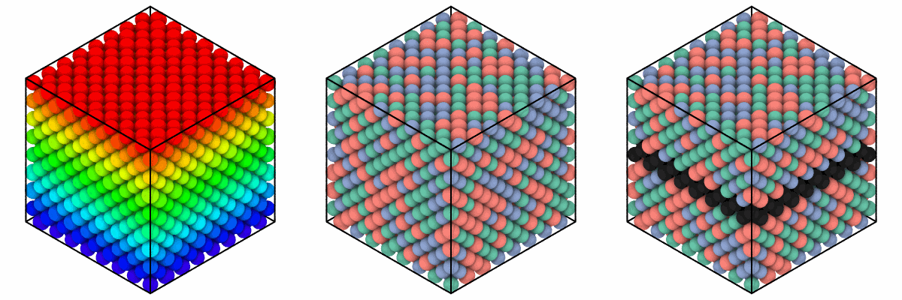

# Coloring atoms

Three functions color the atoms of a system and keep the colors in its
`color` column, which [`render`](rendering.md) draws by default and the next
coloring starts from:

| Function | Colors | As OVITO's |
|---|---|---|
| `color_coding(system, column, colormap="rainbow", value_range=None, *, atoms=None)` | by the values of a column through a colormap | color coding |
| `color_by_type(system, column, *, atoms=None)` | one color for each value of a column | color by type |
| `assign_color(system, color, *, atoms=None)` | in one color | assign color |

Each colors all atoms, or those given as `atoms`, a mask such as
[`System.where`](../getting-started/selecting.md#masks) gives, or indices;
the others keep the colors they had.

```python
import numpy as np

import mdapy as mp
from mdapy.build import build_crystal
from mdapy.visualization import (
    assign_color,
    atom_colors,
    atom_radii,
    color_by_type,
    color_coding,
    render,
)

alloy = build_crystal("fcc", 3.6, elements="Cu", repeat=(8, 8, 8))
rng = np.random.default_rng(7)
alloy = alloy.with_columns(element=rng.choice(["Cu", "Ni", "Al"], size=len(alloy)))

by_height = color_coding(alloy, "positions.z")  # rainbow from bottom to top
by_element = color_by_type(alloy, "element")
layer = alloy.where("positions.z > 12 and positions.z < 16")
marked = assign_color(by_element, "#222222", atoms=layer)
```

The three systems drawn:

```python
from mdapy.visualization import write_png

options = dict(view="iso", width=400, height=400)
write_png(
    "images/colors.png",
    np.hstack([render(by_height, **options), render(by_element, **options),
               render(marked, **options)]),
)  # fmt: skip
```



*Left: rainbow from the lowest to the highest z. Middle: one color for each
of Al, Cu and Ni. Right: a layer in dark gray over the colors by element.*

## Parameters

| Name | Type | Default | Meaning |
|---|---|---|---|
| `column` | str | | for `color_coding`, a column of numbers, a component such as `"velocities.z"` or an expression; for `color_by_type`, a column of one component, such as `"element"`, `"type"` or `"cluster"`, or an expression |
| `colormap` | str | `"rainbow"` | one of [`COLORMAPS`](rendering.md#colormaps) |
| `value_range` | (low, high) | finite range | the values at the ends of the colormap; by default the lowest and highest finite value of the atoms colored; values beyond take the color of their end |
| `color` | color | | `"#rrggbb"`, a name such as `"red"`, or three numbers from 0 to 1 |
| `atoms` | mask or indices | all | the atoms colored |

`color_by_type` gives the values, in increasing order, the colors of
`LABEL_COLORS` in turn: twelve distinct colors, the thirteenth value taking
the first again.

## Results

Each returns the system with the (N, 3) colors from 0 to 1 in its `color`
column; its other columns as they are.

## The colors and radii of atoms

`atom_colors(system, color=None, *, colormap_name="viridis",
value_range=None, elements=None)` gives the (N, 3) colors `render` draws:
those of `color` as [`render`](rendering.md#parameters) takes it, by default
the `color` column, or without one the colors of the elements, those given
in `elements`, such as `{"Cu": "#d4875a"}`, in place of their own.
`atom_radii(system, radius="display", *, elements=None, scale=1.0)` gives
the (N,) radii in Å: the `radius` column, or without one those of the
elements (`"display"`, `"covalent"` or `"vdw"`), those given in `elements`
in place of their own; each times `scale`.

```python
colors = atom_colors(alloy, elements={"Al": "#9ecae1"})
radii = atom_radii(alloy, elements={"Al": 1.0}, scale=0.8)
picture = render(alloy, color=colors, radius=radii, width=400, height=400)
```

## Errors

`InvalidParameter` for an unknown colormap or color, a column of text for
`color_coding`, a column of several components, or a wrong mask.

## See also

- OVITO [Color coding](https://docs.ovito.org/reference/pipelines/modifiers/color_coding.html),
  [Color by type](https://docs.ovito.org/reference/pipelines/modifiers/color_by_type.html)
  and [Assign color](https://docs.ovito.org/reference/pipelines/modifiers/assign_color.html).
