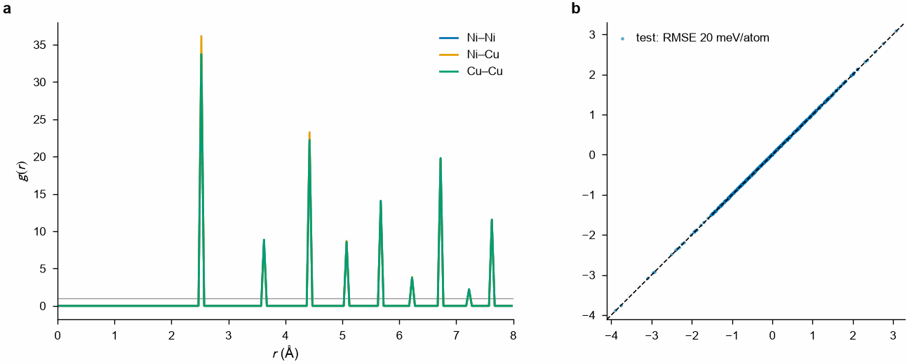
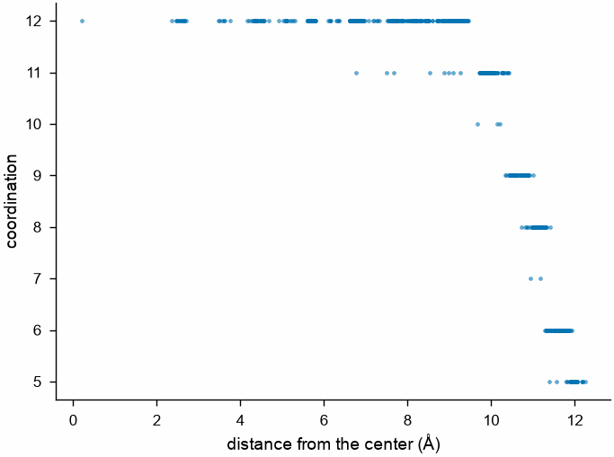

# Plots

`mdapy.visualization.plot` sets matplotlib up for the figures of journals
and plots the results of mdapy: parity plots of energies and forces, radial
distribution functions, structure factors, bond angles, mean squared
displacements, stacking fault energies, counts of structures, phonon
band structures and densities of states, and two columns of the atoms
against each other. It needs matplotlib.

```python
import numpy as np

from mdapy.analysis import RadialDistributionFunction
from mdapy.build import build_crystal, random_alloy
from mdapy.visualization import plot

alloy = random_alloy(
    build_crystal("fcc", 3.6, repeat=(5, 5, 5)), {"Cu": 1, "Ni": 1}, seed=1
)
rdf = RadialDistributionFunction(r_max=8.0, bins=160).compute(alloy)

with plot.style():
    fig, (left, right) = plot.figure("double", nrows=1, ncols=2)
    plot.rdf(rdf, ax=left, partial=True)
    reference = np.random.default_rng(0).normal(size=500)
    plot.parity(
        reference, reference + 0.02, ax=right, label="test", unit="meV/atom", scale=1000
    )
    plot.panel_label(left, "a")
    plot.panel_label(right, "b")
    # plot.save(fig, "figure")  # figure.pdf, figure.svg and figure.png
    fig.savefig("images/plots.png", dpi=200)
```



*a: the partial radial distribution functions of a random CuNi alloy. b: a
parity plot with its error in the legend.*

## Columns of the atoms

`scatter` draws two columns of the atoms, components or expressions against
each other, a point for each atom: here the number of neighbors of the
atoms of a copper nanoparticle, shaken as by heat, against their distance
from its center.

```python
from mdapy.analysis import CoordinationNumber

crystal = build_crystal("fcc", 3.615, elements="Cu", repeat=(8, 8, 8))
center = crystal.box.matrix.sum(axis=0) / 2
particle = crystal.filter(np.linalg.norm(crystal["positions"] - center, axis=1) < 12)
rng = np.random.default_rng(1)
particle = particle.with_columns(
    positions=particle["positions"] + rng.normal(0, 0.1, (len(particle), 3))
)
particle = particle.with_columns(
    **CoordinationNumber(cutoff=3.0).compute(particle).columns(),
    distance=np.linalg.norm(particle["positions"] - center, axis=1),
)
with plot.style():
    fig, ax = plot.figure()
    plot.scatter(particle, "distance", "coordination", ax=ax)
    ax.set_xlabel("distance from the center (Å)")
    fig.savefig("images/scatter.png", dpi=200)
```



*12 neighbors inside the nanoparticle, fewer at its surface, about 12 Å
from its center.*

## Parameters

| Function | Does |
|---|---|
| `style()` | a context in which matplotlib uses `STYLE` and the colors `COLORS` |
| `figure(width="single", height=None, *, nrows=1, ncols=1, **options)` | a figure one column (88 mm) or two (180 mm) wide, or `width` mm; `height` in mm, by default 3/4 of a panel's width per row; `options` go to `plt.subplots` |
| `panel_label(ax, text, *, x=-0.12, y=1.02)` | a bold label at the top left of a panel |
| `save(fig, path, formats=("pdf", "svg", "png"))` | the figure in each format, the text of SVG kept as text |
| `parity(reference, predicted, *, ax=None, label="", unit="", scale=1.0, density=False, color=None)` | predicted against reference values with the diagonal, the root mean square error, times `scale`, in the legend; `density` draws a hexagonal map |
| `scatter(system, x, y, *, ax=None, atoms=None, max_points=20000, color=None)` | two columns, components or expressions of the atoms (or of those of the mask or indices `atoms`) against each other, as `system[x]` takes them, the atoms with finite values; at most `max_points` of them, picked at random with a fixed seed |
| `rdf(result, *, ax=None, partial=False)` | g(r), or the partial functions |
| `structure_factor(result, *, ax=None)` | S(q) |
| `bond_angles(result, *, ax=None)` | the density of bond angles |
| `msd(result, *, timestep=1.0, ax=None, fit=None)` | the MSD against time in ps; `fit=(first, last)` fits a line over those lags, its slope over 6 the diffusion coefficient in the legend |
| `stacking_fault(result, *, ax=None)` | a generalized stacking fault energy in mJ/m² |
| `structure_counts(result, *, ax=None)` | the atoms of each structure type, in its color |
| `band_structure(result, *, ax=None, color=None)` | phonon frequencies along a path, the special points marked; a color for each branch, or one for all |
| `phonon_dos(result, *, ax=None, projected=False)` | a phonon density of states, frequencies upward to stand beside a band structure, and that of each atom of the cell |

Each plot draws on `ax`, by default a new figure, and returns the axes.

## Results

`STYLE` follows the artwork guides of Nature: sans-serif text of 5 to 7
points, lines of 0.5 to 1 point, no top and right spines, fonts embedded as
TrueType. `COLORS` are those of Okabe and Ito, safe for color blindness.
`MM`, `SINGLE` and `DOUBLE` give millimetres and the widths of the columns
in inches.

## Errors

`figure` raises `InvalidParameter` for a width that is neither single,
double nor a positive number, `parity` for values of different sizes, and
`scatter` for a column of several components or `max_points` below 1.
Without matplotlib the plots raise `ImportError`.
