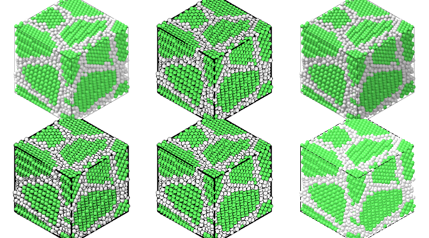
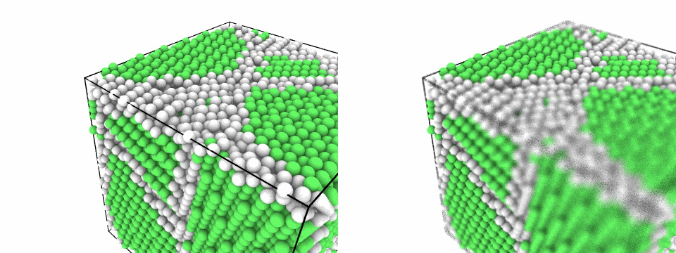
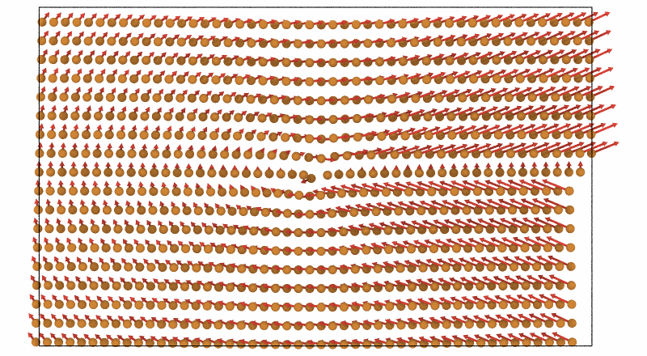

# Rendering

`mdapy.visualization.render` draws a system by ray tracing: atoms as
spheres, optionally bonds, the box, Voronoi cells, surfaces, dislocations and
arrows of vectors, with ambient
occlusion, shadows and outlines, in four styles. A `Scene` takes any
spheres, cylinders and polygons for pictures made by hand.

```python
import mdapy as mp
from mdapy.build import build_crystal, build_polycrystal
from mdapy.identify import CommonNeighborAnalysis
from mdapy.visualization import render

copper = build_crystal("fcc", 3.615, elements="Cu")
grains = build_polycrystal(copper, mp.Box(60.0), 6, seed=1)
structures = CommonNeighborAnalysis().compute(grains)

image = render(grains, color=structures, width=800, height=600)  # (600, 800, 4)
boundaries = render(
    grains, atoms=structures.structure != 1, color=structures, style="flat"
)
```

```python
import numpy as np

from mdapy.visualization import STYLES, write_png

pictures = [
    render(grains, color=structures, style=style, width=400, height=300, device="auto")
    for style in STYLES
]
write_png("images/styles.png", np.hstack(pictures))
```



*The four styles on a polycrystal colored by common neighbor analysis:
fast, matte, shiny and flat.*

## Parameters

`render(system, path=None, *, atoms=None, color=None, colormap="viridis",
value_range=None, representation="spheres", radius=None, bonds=None,
bond_radius=None, box=True,
box_radius=None, box_color="black", polyhedra=None, polyhedra_alpha=0.6,
polyhedra_color="atom", polyhedra_edges=None, mesh=None, mesh_color="#8fb0d8",
mesh_alpha=1.0, dislocations=None, dislocation_radius=0.5,
burgers_vectors=False, burgers_scale=3.0, burgers_radius=0.3,
burgers_color=(0.7, 0.7, 0.7), vectors=None, vector_scale=1.0,
vector_radius=0.5, vector_color=(1.0, 1.0, 0.0), vector_alignment="base",
lines=None, line_radius=0.1, line_color=(0.6, 0.6, 0.6), wrap_lines=False,
**options)`

| Name | Type | Default | Unit | Meaning |
|---|---|---|---|---|
| `path` | str or path | `None` | | a PNG file to write |
| `atoms` | mask or indices | all | | the atoms shown |
| `color` | | the `color` column, else elements | | the colors of the atoms, below |
| `colormap` | str | `"viridis"` | | one of `COLORMAPS`, for values: [below](#colormaps) |
| `value_range` | (low, high) | finite range | | the values at the ends of the colormap |
| `representation` | str | `"spheres"` | | how atoms and bonds are drawn, below; it sets the defaults of `radius`, `bonds` and `bond_radius` |
| `radius` | float, (N,) or str | the `radius` column, else of the representation | Å | the radius of the atoms, or those of the elements: `"display"`, `"covalent"` or `"vdw"` |
| `bonds` | float, `NeighborList`, `"covalent"` or `"topology"` | of the representation | Å | bonds between atoms closer than a cutoff, the pairs of a list, covalent bonds, or the bonds of the topology of the system, such as those of a data file or of [`create_bonds`](../build/bonds.md) |
| `bond_radius` | float | of the representation | Å | |
| `box`, `box_radius` | bool, float | `True`, 0.1 × radius | Å | the edges of the box |
| `box_color` | color | `"black"` | | their color |
| `polyhedra` | `VoronoiPolyhedra` | `None` | | the [Voronoi cells](../analysis/voronoi.md) of the atoms shown |
| `polyhedra_alpha` | float | 0.6 | | their opacity |
| `polyhedra_color` | str | `"atom"` | | faces colored as their atoms, or `"edges"` by their number of edges |
| `polyhedra_edges` | float | 0.05 × radius | Å | the radius of the edges of the cells, 0 for none |
| `mesh` | `TriangleMesh` | `None` | | a surface, such as that of a [surface mesh](../analysis/surface-mesh.md); triangles across a periodic boundary are cut there and the part outside moved in through the opposite face |
| `mesh_color` | color or (F, 3) | light blue | | one color, or one per triangle |
| `mesh_alpha` | float | 1 | | its opacity |
| `dislocations` | `DislocationResult` | `None` | | dislocation lines, such as those of the [dislocation analysis](../analysis/dislocations.md): tubes in the colors of the families of their Burgers vectors, cut at the periodic faces of the box |
| `dislocation_radius` | float | 0.5 | Å | the radius of the tubes |
| `burgers_vectors` | bool | `False` | | also an arrow from the middle of each line along its Burgers vector in space |
| `burgers_scale` | float | 3 | | the length of the arrows in Burgers vectors |
| `burgers_radius` | float | 0.3 | Å | the radius of their shafts |
| `burgers_color` | color or `"family"` | light gray | | one color for the arrows, or the color of each line |
| `vectors` | str or (N, 3) | `None` | | an arrow for each atom shown: a column of three components, such as `displacement`, `velocities` or `forces`, or vectors; [below](#vectors) |
| `vector_scale` | float | 1 | | the length of the arrows in units of the vectors; negative reverses them |
| `vector_radius` | float | 0.5 | Å | the radius of their shafts |
| `vector_color` | color or `"atom"` | yellow | | one color for the arrows, or the color of each atom |
| `vector_alignment` | str | `"base"` | | the point of the arrow at its atom: `base`, `center` or `head` |
| `lines` | (M, T, 3) or list of (T, 3) | `None` | Å | polylines, such as the paths of [`trajectory_lines`](../analysis/trajectory-lines.md) |
| `line_radius`, `line_color` | float, color | 0.1, gray | Å | their radius and color |
| `wrap_lines` | bool | `False` | | cut the lines at the periodic faces of the box and move the parts outside in through the opposite faces |

| Representation | Atoms | Bonds |
|---|---|---|
| `spheres` | display radii | none, radius 0.25 Å when given |
| `ball_and_stick` | a quarter of the van der Waals radii | covalent, radius 0.15 Å |
| `space_filling` | van der Waals radii | none |
| `licorice` | as wide as the bonds | covalent, radius 0.2 Å |

`color` is one of: `None` for the `color` column of the system, which
[`color_coding`, `color_by_type` and `assign_color`](colors.md) set, or
without one the colors of the elements; a single color,
`"#rrggbb"`, a name such as `"red"` or three numbers from 0 to 1; (N, 3)
colors; a column name or (N,) values, through the colormap; or a structure
result such as that of [`CommonNeighborAnalysis`](../analysis/cna.md), in
its colors. The colors and display radii of the elements are those of
OVITO, and for the elements OVITO leaves out the colors of Jmol and the
covalent radii; covalent radii are those of
[Cordero et al. (2008)](../reference/references.md#cordero2008), van der
Waals radii those of [Alvarez (2013)](../reference/references.md#alvarez2013),
1.5 Å and 2 Å for elements without one. Covalent bonds,
`covalent_bonds(system)`, join the atoms closer than the sum of their
covalent radii and 0.45 Å, as in Jmol.
Bonds are drawn as two halves in the colors of their atoms; a bond to a
periodic image is drawn as the half next to each atom only, so nothing
leaves the box.

### Colormaps

`colormap(values, name="viridis", value_range=None)` gives the (N, 3)
colors of values; `COLORMAPS` holds the names. rainbow (OVITO's default),
viridis, magma, jet, hot, blue_white_red and gray are computed as OVITO's
color coding computes them, viridis and magma from their tables of 256
colors; plasma and coolwarm are mdapy's own.

The `options` are those of `Scene.render`:

| Name | Type | Default | Meaning |
|---|---|---|---|
| `width`, `height` | int | 1200, 900 | size in pixels |
| `view` | str or (3,) | `"iso"` | `top`, `bottom`, `front`, `back`, `left`, `right`, `iso`, or a direction of view |
| `up` | (3,) | of the view | the direction up in the picture |
| `perspective`, `fov` | bool, float | `False`, 30 | a perspective camera and its vertical angle in degrees |
| `zoom` | float | 1 | magnification of the scene framed to fill the picture |
| `focus` | (3,) | middle of the scene | the point in Å at the middle of the picture |
| `span` | float | the scene framed | the length in Å the picture shows from bottom to top at the focus, in place of the framing and `zoom`: with `focus`, the region a viewport shows |
| `aperture` | float | 0 | the radius in Å of the lens of a perspective camera: 0 for a picture sharp everywhere, more for [depth of field](#depth-of-field-and-soft-shadows) |
| `focal_distance` | float | to the focus | the distance in Å from the camera along the view to the plane that stays sharp |
| `style` | str | `"matte"` | one of the styles below |
| `background` | color or `None` | `"white"` | `None` for transparent |
| `device` | str | `"cpu"` | `"cpu"`, `"gpu"`, or `"auto"` for the GPU when there is one; see below |
| `progress`, `cancel` | | `None` | as in [Parallelism](../getting-started/parallelism.md#progress-and-cancellation) |

| Style | Look |
|---|---|
| `fast` | quick, as the viewports of OVITO: an ambient part, a light from the viewer and a broad highlight from the upper left, neither occlusion nor shadows |
| `matte` | matte spheres, as the pictures of the Tachyon renderer of OVITO: a bright sky darkened by ambient occlusion, a weak light from the viewer with sharp shadows |
| `shiny` | shiny spheres with a metallic sheen, after the pictures of the OSPRay renderer of OVITO: light from a sky and a wide key light that bounces once between the atoms, soft shadows and small highlights; about three times slower than `matte` |
| `flat` | plain colors, every atom outlined, as ASE draws atoms; for small systems |

Any setting of a style can be changed by name: `ambient`, `diffuse`,
`specular`, `shininess`, `metalness` (from 0 to 1: metals reflect less
light diffusely and color their highlights), `key`, `highlight` and `fill`
(directions toward the key light, the light of the highlights, by default
the key light, and the fill light: right, up and toward the viewer),
`fill_intensity`, `base_light` (light every surface gets, whatever hides
it), `srgb` (light the colors as given in sRGB, as the renderers of OVITO
do, in place of linear light: stronger contrast), `ao_samples`,
`ao_distance` (Å, default 3 times the median radius), `ao_strength`,
`shadows`, `shadow_strength`, `flat`, `toon_levels`, `outline_width`
(pixels), `outline_depth` (Å), `outline_color`, `fog`, `supersample`
(rays per pixel along each axis), `samples` (rays per subpixel, the first
through its middle and the others anywhere in it: more for smoother soft
shadows, depth of field and global illumination), `light_size` (the
angular radius of the key light in radians, 0 for a point, wider for softer
shadows) and, for global illumination, `bounces` (0 for none).
`style_settings(style)` gives every setting of a style as a dictionary.

## Depth of field and soft shadows

```python
import numpy as np

from mdapy.visualization import write_png

camera = {"perspective": True, "fov": 40, "focus": [45, 15, 45], "span": 70}
sharp = render(grains, color=structures, width=480, height=360, **camera)
blurred = render(
    grains,
    color=structures,
    width=480,
    height=360,
    **camera,
    aperture=3.0,
    light_size=0.15,
    supersample=1,
    samples=32,
)
write_png("images/depth_of_field.png", np.hstack([sharp, blurred]))
```



*The polycrystal through a pinhole, left, and through a lens 3 Å wide that
keeps the front left around the focus sharp, lit by a key light 0.15 rad
wide, right.*

A perspective camera with an `aperture` sees through a lens of that radius:
the plane `focal_distance` from the camera, through the focus unless given,
stays sharp, and things blur the more the farther they are from it. A key
light `light_size` radians wide casts soft shadows in every style. Both are
sampled by the rays of each pixel and look grainy with few of them: raise
`samples` for smoother pictures, at a cost in time that grows with it.

## On the GPU

With `device="gpu"` the rays are traced on the GPU: with Metal on macOS, and
with Vulkan on Linux, whose loader and driver come with the graphics
drivers of NVIDIA, AMD and Intel (a build from source needs Vulkan's
headers, see [Installation](../getting-started/installation.md#pictures-on-the-gpu)).
`gpu_available()` tells whether there is a GPU. A GPU with ray tracing
units uses them: on Linux those of NVIDIA RTX, AMD Radeon RX 6000 and later
and Intel Arc, for every ray; on macOS those of M3 and later, for the rays
of occlusion and shadows. The environment variable
`MDAPY_GPU_RAY_TRACING=0` turns them off. The picture is the same as on the
processor, with the same random samples in the same precision, up to
rounding at a few edges. For a million atoms at 1920 × 1080:

| Device | matte | shiny |
|---|---|---|
| Apple M5, GPU | 0.4 s | 2.0 s |
| the same without its ray tracing units | 1.1 s | 2.9 s |
| Apple M5, processor | 4.6 s | 13.4 s |
| NVIDIA RTX A2000 | 0.7 s | 1.4 s |
| the same without its ray tracing units | 1.5 s | 3.4 s |
| Intel Core i5-12600K, processor | 4.9 s | 14.0 s |

```python
from mdapy.visualization import gpu_available

device = "gpu" if gpu_available() else "cpu"
picture = render(grains, color=structures, device=device)
```

## Molecules

Organic molecules are drawn with covalent bonds, found from the elements:

```python
import numpy as np

# benzene: C-C 1.39 Å, C-H 1.09 Å
angles = np.arange(6) * np.pi / 3
ring = np.stack([np.cos(angles), np.sin(angles), np.zeros(6)], axis=1)
benzene = mp.System(
    np.vstack([1.39 * ring, 2.48 * ring]), elements=["C"] * 6 + ["H"] * 6
)
drawn = {
    representation: render(
        benzene,
        representation=representation,
        box=False,
        view=(0.3, 0.6, -1.0),
        style="shiny",
        width=400,
        height=300,
        device="auto",
    )
    for representation in ("ball_and_stick", "licorice", "space_filling")
}
write_png("images/molecules.png", np.hstack(list(drawn.values())))
```


*Benzene in the representations ball_and_stick, licorice and
space_filling, in the shiny style.*

## Vectors

An arrow along a vector of each atom, such as its displacement, velocity or
force: here the displacements of an edge dislocation put into copper.

```python
import numpy as np

from mdapy.build import build_crystal, insert_dislocation

# x along [1-10], y normal to the (111) glide plane, z along the line
crystal = build_crystal(
    "fcc",
    3.615,
    elements="Cu",
    orientation=[(1, -1, 0), (1, 1, 1), (-1, -1, 2)],
    repeat=(24, 6, 1),
)
center = crystal.box.matrix.diagonal() / 2 + [0.1, 0.1, 0.0]
edge = insert_dislocation(crystal, [3.615 / np.sqrt(2), 0, 0], line="z", center=center)
edge = edge.with_columns(displacement=edge["positions"] - crystal["positions"])
render(
    edge,
    "images/vectors.png",
    radius=0.5,
    vectors="displacement",
    vector_scale=2.5,
    vector_radius=0.12,
    vector_color=(0.85, 0.25, 0.2),
    view="top",
    width=800,
    height=440,
)
```



*The displacements of the atoms around an edge dislocation, 2.5 times
their length, seen along the line: the planes above the glide plane open
around the extra half plane and close below it.*

The arrows are those of OVITO's vector display with normal shading: a shaft
of `vector_radius`, which is OVITO's arrow width, and a head 2.5 times as
wide and 4.5 times as long as that radius; an arrow shorter than its head is
a cone only, narrowed in proportion. OVITO draws flat arrows facing the
viewer by default. Zero vectors and atoms not shown get no arrow.

## Scenes

```python
import numpy as np

from mdapy.visualization import Scene

scene = Scene()
scene.add_spheres([[0, 0, 0], [2.5, 0, 0]], 1.0, [[0.8, 0.5, 0.2], [0.2, 0.5, 0.8]])
scene.add_cylinders([[0, 0, 0]], [[2.5, 0, 0]], 0.3, (0.5, 0.5, 0.5))
scene.add_triangles([[[-2, -2, -1.5], [4, -2, -1.5], [1, 3, -1.5]]], "gray", alpha=0.5)
picture = scene.render(width=400, height=300, style="shiny", view="front")
```

| Method | Adds |
|---|---|
| `add_spheres(centers, radii, colors, *, ids=None)` | spheres |
| `add_cylinders(starts, ends, radii, colors, *, ids=None)` | cylinders without caps |
| `add_triangles(vertices, colors, *, alpha=1.0, ids=None)` | (T, 3, 3) triangles, seen from both sides, opaque or not |
| `add_polygons(vertices, corner_offsets, corners, colors, *, alpha=1.0, ids=None)` | convex polygons, in the layout of `VoronoiPolyhedra` |
| `add_box(box, *, radius=0.15, color="black")` | the twelve edges of a box |

Outlines separate primitives of different `ids`. `write_png(path, image)`
writes a picture; `voxel_faces(values, box)` gives the cells of a grid over
the box as triangles on its faces, for `mesh` (see
[Isosurfaces and voxels](../analysis/isosurface.md)); `colormap(values, name, value_range)`,
`element_colors(elements)` and `element_radii(elements, kind="display")` give the colors
and radii used by `render`.

## Results

An (height, width, 4) uint8 array of RGBA pixels in sRGB, rows from the top,
the same for any number of threads.

## Errors

They raise `InvalidParameter` for an unknown style, view, colormap, color
or option, a size that is not positive, a negative aperture or one with an
orthographic camera, a focal distance that is not positive, arrays of the wrong shape, an
opacity out of [0, 1], a polygon of fewer than three corners, a negative
id or an invalid mask of atoms; `Cancelled` when cancelled.

## Definition

Every pixel traces `supersample`² × `samples` rays from an orthographic or
perspective camera into a bounding volume hierarchy of the primitives;
through a lens, each ray starts at a random point of it and passes through
the point where the ray from its middle meets the sharp plane. At the nearest
hit, the color of the primitive, in linear RGB (or as given with `srgb`),
is lit by `base_light`, by an ambient term weighted by ambient occlusion,
the fraction of `ao_samples` rays that leave without hitting anything
closer than `ao_distance` (cosine-weighted about the normal, one in each of
`ao_samples` rings of equal weight, their turns a golden angle apart), by
the diffuse light of the key light, darkened by its shadow toward a random
point of the light, and of the fill light, and by a Phong highlight, the
light from `highlight` mirrored about the normal toward the viewer. A metal
reflects 1 − 0.6 `metalness` of the diffuse light and colors its
highlights, as the rasterizer of OVITO approximates metals. See-through triangles
add their color and let the ray go on. An outline is drawn on the pixels
next to a different primitive that lies at least `outline_depth` closer, or
next to the background. The rays of a pixel are averaged, over the
background, into sRGB.

With `bounces` above 0, each ray instead follows `samples` paths, the first
through the center of its part of the pixel and the others anywhere in it.
At each surface a path adds the light of the key light, sampled over a disk
`light_size` wide and blocked by anything in the way, then turns into a
cosine-weighted direction about the normal (the first turns of the paths
of a subpixel spread over rings of equal weight): if it leaves the scene it adds
the sky, of brightness `ambient`, otherwise it goes on to the next surface,
its light now colored by the surfaces it met, for at most `bounces` more
surfaces. Shadows soften and corners darken without ambient occlusion, and
colors bleed onto neighbors; the noise falls as the samples grow.
